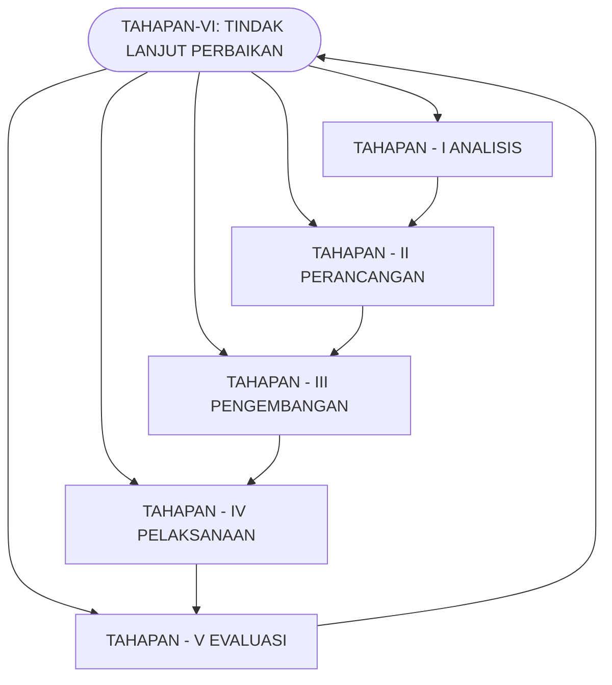

## Dokumen Kurikulum TRM 2024
## Teknologi Rekayasa Mekantronika

logo: Universitas Muhammadiyah Prof. DR. HAMKA

## **DOKUMEN**

### **Penyusunan Kurikulum Pendidikan Tinggi**

#### **Program Studi Teknologi Rekayasa Mekantronika**

Jakarta, 16 Agustus 2024

**Nama Ketua Tim** : **Akhmad Rizal Dzikrillah, S.T., M.TI**
**NIDN** : **0328056901**
**Program Studi** : **Teknologi Rekayasa Mekantronika**
**Fakultas** : **Teknologi Industri dan Informatika**
**Universitas** : **Universitas Muhammadiyah Prof. DR. HAMKA**

**UNIVERSITAS MUHAMMADIYAH PROF. DR. HAMKA**
**Tahun 2024**

logo: logo

## **TIM PENYUSUN**

**Akhmad Rizal Dzikrillah, S.T., M.TI**
**Rosalina, S.T., M.T**
**Nur Chalik Azhar, S.Kom.,**
**M.Kom**
**Agus Fikri, S.T., M.T**
**Yos Nofendri S.Pd MS.ME**

### **Advisory Board**

**Berlian Kushari, S.T., M.Eng**
(Universitas Islam Indonesia)

**Ir. Sri Winiarti, S.T., M.Cs**
(Universitas Ahmad Dahlan)

**Ahmad Fajar, S.T., M.Sc**
(Alumni Prodi TI UHAMKA)

**Siti Malina**
(Google Cloud Learning)

logo: logo

## **DAFTAR ISI**

| TIM PENYUSUN | II |
| --- | --- |
| DAFTAR ISI | III |
| KATA PENGANTAR | v |
| HALAMAN PENGESAHAN | vi |
| IDENTITAS PROGRAM STUDI | vii |
| 1 LANDASAN KURIKULUM | 1 |
| 1.1 LANDASAN FILOSOFIS | 1 |
| 1.2 LANDASAN SOSIOLOGIS | 1 |
| 1.3 LANDASAN HISTORIS | 2 |
| 1.4 LANDASAN HUKUM | 2 |
| 2 VISI, MISI, TUJUAN, DAN STRATEGI PROGRAM STUDI | 3 |
| 2.1 VISI | 3 |
| 2.2 MISI | 3 |
| 2.3 TUJUAN | 4 |
| 2.4 STRATEGI | 4 |
| 2.5 UNIVERSITAS VALUE | 4 |
| 3 HASIL EVALUASI KURIKULUM & TRACER STUDY | 5 |
| 3.1 EVALUASI KURIKULUM | 5 |
| 3.2 TRACER STUDY | 5 |
| 4 PROFIL LULUSAN & RUMUSAN CAPAIAN PEMBELAJARAN LULUSAN (CPL) | 9 |
| 4.1 PROFIL LULUSAN | 9 |
| 4.2 PERUMUSAN CPL | 10 |
| 4.3 MATRIK HUBUNGAN CPL DENGAN PROFIL LULUSAN | 11 |
| 4.4 MATRIK HUBUNGAN CPL DENGAN KRITERIA CAPAIAN PEMBELAJARAN (CP) IABEE | 12 |
| 5 PENENTUAN BAHAN KAJIAN | 19 |
| 5.1 GAMBARAN Body of Knowledge (BoK) | 19 |
| 6 PEMBENTUKAN MATA KULIAH DAN PENENTUAN BOBOT SKS | 16 |
| 7 STRUKTUR MATAKULIAH DLM KURIKULUM PROGRAM STUDI | 26 |
| 7.1 MATRIK KURIKULUM | 26 |
| 7.2 PETA KURIKULUM BERDASARKAN CPL PRODI | 28 |
| 8 DAFTAR SEBARAN MATA KULIAH TIAP SEMESTER | 38 |
| 9 RENCANA PEMBELAJARAN SEMESTER (RPS) | 46 |
| 10 PENILAIAN PEMBELAJARAN | 59 |
| 10.1 RUBRIK | 62 |
| 10.2 PORTOFOLIO PENILAIAN HASIL BELAJAR | 65 |

logo: logo

| 11 | IMPLEMENTASI HAK BELAJAR MAHASISWA MAKSIMUM 3 SEMESTER | 73 |
| --- | --- | --- |
| 12 | PENGELOLAAN & MEKANISME PELAKSANAAN KURIKULUM | 76 |
| 13 | PENUTUP | 77 |
| DAFTAR PUSTAKA | 78 |  |

# **KATA PENGANTAR**

*Segala puji bagi Allah Subhanahu Wa Ta'ala yang telah memberikan nikmat serta hidayah-Nya terutama nikmat kesempatan dan kesehatan sehingga Tim Penyusun Kurikulum Prodi Teknologi Rekayasa Mekantronika dapat menyelesaikan Kurikulum Teknologi Rekayasa Mekantronika 2024. Shalawat beserta salam kita sampaikan kepada Nabi besar kita Muhammad SAW yang telah memberikan pedoman hidup yakni Al-qur'an dan Sunnah untuk keselamatan umat di dunia.*

*Kurikulum ini merupakan salah satu instrumen penting di Program Studi Teknologi Rekayasa Mekantronika Fakultas Teknik pada Universitas Muhammadiyah Prof. DR. HAMKA guna mendukung fleksibilitas kebutuhan pembelajaran yang ditingkatkan akhir-akhir ini untuk merangsang meningkatnya prestasi mahasiswa, adanya sistem pembelajaran berdasarkan capaian dan kegiatan MBKM (Merdeka Belajar Kampus Merdeka). Selanjutnya Tim Penyusun mengucapkan terima kasih yang sebesar-besarnya kepada Bapak Dr. Dan Mugisidi, S.T., M.Si selaku Dekan Fakultas Teknik yang telah memberikan usulan tinjauan kurikulum berdasarkan mata kuliah pengayaan dan kepada segenap pihak yang telah memberikan bimbingan serta arahan selama penulisan dan penyusunan kurikulum ini.*

*Akhirnya Tim Penyusun menyadari bahwa masih banyak terdapat kekurangan-kekurangan dalam kurikulum ini, seiring sejalannya waktu maka dari itu Tim Penyusun mengharapkan kritik dan saran yang konstruktif dari para pelaku, pengguna kurikulum ini demi kesempurnaannya di masa yang akan datang.*

*Jakarta, Agustus 2024*
*Tim Penyusun*

logo: logo

## **HALAMAN PENGESAHAN**

### **KURIKULUM PENDIDIKAN TINGGI TAHUN 2024 PROGRAM SARJANA STRATA 1 (S1) PROGRAM STUDI TEKNOLOGI REKAYASA MEKATRONIKA FAKULTAS TEKNIK UNIVERSITAS MUHAMMADIYAH PROF. DR. HAMKA**

Kurikulum ini disusun berdasarkan Undang-Undang No.12 Tahun 2012 dan Peraturan Menteri Riset, Teknologi dan Pendidikan Tinggi No. 44 Tahun 2015

Dan telah disepakati Bersama pada Tingkat program studi dalam rapat pleno pengesahan kurikulum pada tanggal 13 Agustus 2024
Tim Penyusun
1. Akhmad Rizal Dzikrillah, S.T., M.TI
2. Rosalina, S.T., M.T
3. Agus Fikri, S.T., M.T
4. Yos Nofendri, S.Pd., M.S.ME
5. Nur Chalik Azhar, S.Kom., M.Kom

logo: logo

Mengetahui,
Dekan Fakultas
Teknik

signature: Dr. Dan Mugisidi, ST., M.Sc

Dr. Dan Mugisidi, ST.,
M.Sc
NIDN. 0301126901

Jakarta, 16 Agustus
2024 Ketua Program
Studi

Akhmad Rizal Dzikrillah, S.T., M.TI
NIDN. 0328056901

logo: Universitas Muhammadiyah Prof. DR. HAMKA

## **IDENTITAS PROGRAM STUDI**

| 1 | Nama Perguruan Tinggi (PT) | Universitas Muhammadiyah Prof. DR. HAMKA |
| --- | --- | --- |
| [ ] PTN [ ] PTS |  |  |
| 2 | Fakultas | Teknologi Industri dan Informatika |
| 3 | Jurusan/Departemen | - |
| 4 | Program Studi | Teknologi Rekayasa Mekantronika |
| 5 | Jenjang Pendidikan | D4 |
| 6 | Ijin Operasional PS | 138/DIKTI/Kep/1997 |
| 7 | Status Akreditasi | Baik |
| 8 | SK BAN PT | 12954/SK/BAN-PT/Ak-PPJ/S/XII/2024 |
| 9 | Gelar Lulusan | S.Tr |
| 10 | Jumlah Mahasiswa | 1143 |
| 11 | Jumlah Dosen | 22 |
| 12 | Alamat Prodi | Jl. Tanah Merdeka No. 6, Rambutan, Ciracas, Jakarta Timur |
| 13 | Telp. | 021-8400941 |
| 14 | Web PRODI/PT | https://ft.uhamka.ac.id/prodi/informatika/ |

# 1 Landasan Kurikulum

## 1.1 Landasan Filosofis

Memberikan landasan kurikulum secara filosofis bagaimana pengetahuan dikaji dan dipelajari agar mahasiswa memahami hakikat hidup dan memiliki kemampuan yang mampu meningkatkan kualitas hidupnya baik secara individu maupun di masyarakat.

a. UHAMKA merupakan salah satu perguruan tinggi Muhammadiyah yang melandasi kegiatan pengembangannya dengan senantiasa berpegang teguh pada ajaran Islam, yaitu Al-Qur'an dan As-Sunnah. Karena Muhammadiyah telah menetapkan negaraPancasila sebagai Darul 'Ahdi wa Syahadah, yang bermakna NKRI yang berdasarkan Pancasila adalah bentuk negara yang ideal, maka UHAMKA juga menetapkan Pancasila sebagai landasan ideologisnya.

b. UHAMKA bersama Muhammadiyah sebagai bagian tak terpisahkan dari masyarakat dan bangsa Indonesia berusaha mewujudkan Indonesia yang berkembang sebagaimana amanat Pembukaan UUD 1945.

c. Kontribusi UHAMKA sebagai perguruan tinggi untuk mewujudkan masyarakat berkembang akan tergambarkan pada perangkat rencana dan pengaturan mengenai tujuan, isi, dan bahan pelajaran serta cara yang digunakan sebagai pedoman penyelenggaraan kegiatan pembelajaran untuk mencapai tujuan pendidikan tertentu. Perangkat dimaksud adalah kurikulum (Undang-undang Sistem Pendidikan Nasional tahun 2003). Oleh karenanya kurikulum memiliki nilai penting karena menggambarkan komitmen dan konsistensi UHAMKA dalam upaya mewujudkan visi dan misinya.

d. Mengekstraksi nilai-nilai ajaran Nabi Muhammad SAW dan dari pandangan tokoh Pendidikan seperti KH. Ahmad Dahlan, buya HAMKA, dan Ki Hajar Dewantara juga menjadi rujukan dalam pengembangan kurikulum UHAMKA. Sebagai contoh, Filsafat pendidikan Muhammadiyah tidak bisa dilepaskan dari ide dan gagasan K.H. Ahmad Dahlan. Nilai-nilai pendidikan Islam dari Buya Hamka juga akan memberi warna dan karakter dalam pembekalan Al Islam Kemuhammadiyahan, sebagai komponen kurikulum di UHAMKA.

## 1.2 Landasan Sosiologis

Kurikulum sebagai perangkat Pendidikan yang terdiri dari tujuan, materi, kegiatan belajar dan lingkungan belajar yang positif bagi perolehan pengalaman pembelajaran harus relevan dengan perkembangan personal dan sosial pembelajar. Kurikulum tidak boleh lepas dari konstruk sosialnya. Artinya, kurikulum yang dikembangkan UHAMKA harus dapat mengakomodasi dan beradaptasi dengan karakteristik sosial masyarakat. DKI Jakarta dan sekitarnya, yang lazim disebut Jabodetabek merupakan

investor terbesar dalam hal kepercayaan memberi input, sekaligus menjadi pengguna jasa mayoritas lulusan UHAMKA. Jabodetabek merupakan wilayah multietnis, bisa disebut miniatur heterogenitas Indonesia, dengan tingkat kemampuan ekonomi yang sangat bervariasi, dan tingkat kepatuhan masyarakat pada ketokohan tertentu (*paternalistic*) yang sudah sangat longgar. Sebagai masyarakat sibuk, keluarga di Jabodetabek dimungkinkan memiliki intensitas interaksi yang sangat rendah di antara anggotanya.

Hal ini bisa menjadi pangkal dari berbagai persoalan, yang harus dicari solusiya, termasuk oleh dunia pendidikan. Berbagai karakteristik sosial kemasyarakatan yang demikian termasuk kategori sebagai “kebutuhan masyarakat” dan “perkembangan jaman” yang harus diakomodasi dalam pengembangan kurikulum UHAMKALandasan Historis

## 1.3 Landasan Historis

Bahwasannya perkembangan Pendidikan sebelum abad 21, menjelang abad 21 hingga abad 21 sekarang ini dan ke depan, diperlukan evaluasi atas landasan berpikir dan praktik Pendidikan dalam rangka merespon perubahan kebutuhan masyarakat dengan dinamika yang tinggi sehingga relevansi kurikulum tetap terjaga dan memenuhi tantangan masa depan. Landasan historis tentu menguatkan kurikulum yang akan dihasilkan karena diyakini mampu memfasilitasi mahasiswa belajar sesuai dengan zamannya, mewariskan nilai budaya dan sejarah keemasan masa lalu, dan mempersiapkan mahasiswa agar dapat hidup lebih baik di abad 21, memiliki peran aktif di era industri 4.0 serta mampu membaca tanda-tanda perkembangannya.

## 1.4 Landasan Hukum

1. Undang-Undang Republik Indonesia Nomor 14 Tahun 2005 tentang Guru dan Dosen (Lembaran Negara Republik Indonesia Tahun 2005 Nomor 157, Tambahan Lembaran Negara Republik Indonesia Nomor 4586);
2. Undang-Undang Republik Indonesia Nomor 12 Tahun 2012 tentang Pendidikan Tinggi (Lembaran Negara Republik Indonesia Tahun 2012 Nomor 158, Tambahan Lembaran Negara Republik Indonesia Nomor 5336);
3. Peraturan Presiden Republik Indonesia Nomor 8 Tahun 2012, Tentang Kerangka Kualifikasi Nasional Indonesia (KKNI);
4. Peraturan Menteri Pendidikan dan Kebudayaan Republik Indonesia Nomor 73 Tahun 2013, Tentang Penerapan KKNI Bidang Perguruan Tinggi;
5. Peraturan Menteri Pendidikan dan Kebudayaan Republik Indonesia Nomor 3 Tahun 2020, Tentang Standar Nasional Pendidikan Tinggi;

6. Peraturan Menteri Pendidikan dan Kebudayaan Republik Indonesia Nomor 5 Tahun 2020, Tentang Akreditasi Program Studi dan Perguruan Tinggi;
7. Peraturan Menteri Pendidikan dan Kebudayaan Republik Indonesia Nomor 7 Tahun 2020, Tentang Pendirian, Perubahan, Pembubaran PTN, dan Pendirian, Perubahan, Pencabutan Izin PTS;
8. Peraturan Menteri Pendidikan dan Kebudayaan Republik Indonesia Nomor 81 Tahun 2014, Tentang Ijazah, Sertifikat Kompetensi, Dan Sertifikat Profesi Pendidikan Tinggi;
9. Peraturan Menteri Riset, Teknologi, dan Pendidikan Tinggi Republik Indonesia
10. Buku Panduan Penyusunan KPT di Era Industri 4.0 untuk Mendukung Merdeka Belajar Kampus Merdeka, Ditjen Belmawa, Dikti-Kemendikbud, 2020.
11. Buku Panduan Merdeka Belajar – Kampus Merdeka, Ditjen Belmawa, Dikti-Kemendikbud, 2020.
12. Surat Keputusan Rektor Nomor:897/A.01.02/2020 Tentang Implementasi Merdeka Belajar Kampus Merdeka (MBKM) Universitas Muhammadiyah Prof. DR. HAMKA, Tanggal 09 Oktober 2020.
13. Surat Keputusan Rektor Nomor:1425/A.01.01/2020 Tentang Pedoman Penyusunan Kurikulum Program Studi di Lingkungan Universitas Muhammadiyah Prof. DR. HAMKA, Tanggal 28 Desember 2020.

## 2 **Visi, Misi, Tujuan, dan Strategi Program Studi**

### 2.1 **Visi**
**"Menjadi Program Studi Teknologi Rekayasa Mekantronika berlandaskan Prophetic Teaching yang mampu mencetak lulusan yang cerdas secara spiritual, intelektual, emosional, dan sosial dalam menghasilkan karya teknologi unggul di bidang mekatronika."**

### 2.2 **Misi**
1. Menyelenggarakan pendidikan sains dan teknologi rekayasa mekatronika yang terintegrasi dengan nilai-nilai Al Islam dan Kemuhammadiyahan dalam rangka menghasilkan mahasiswa cerdas secara spiritual, intelektual, emosional, dan sosial.
2. Menyelenggarakan penelitian untuk menghasilkan karya teknologi unggul di bidang mekatronika dalam rangka mendukung terciptanya masyarakat yang berkembang;
3. Memberikan sumbangsih keahlian di bidang mekatronika dalam bentuk penyelenggaraan pengabdian kepada masyarakat untuk kemashlahatan peradaban umat.
4. Membangun layanan prodi yang berbasis teknologi informasi terpadu.

# 2.3 **Tujuan:**

1. Menghasilkan lulusan bidang teknologi rekayasa mekatronika yang mampu meng-update kemampuan diri ilmunya di dunia kerja.
2. Menghasilkan sumber daya manusia di bidang teknologi rekayasa mekatronika yang cerdas, kompetitif dan berjiwa wirausaha yang berpegang pada nilai-nilai Islam.
3. Menghasilkan sistem pendidikan yang transparan, inovatif, berkualitas dan akuntabel.
4. Menghasilkan lulusan bidang teknologi rekayasa mekatronika yang mampu berkompetisi, memimpin umat dan menciptakan lapangan kerja di bidang ilmu teknik.
5. Menghasilkan kader intelektual di bidang teknologi rekayasa mekatronika yang beriman dan bertaqwa kepada Allah, berakhlak mulia, percaya kepada diri sendiri serta dapat beramal sesuai bidang ilmu dengan ikhlas demi terwujudnya masyarakat utama yang diridhoi Allah.
6. Menghasilkan kader persyarikatan, kader umat dan kader bangsa dibidang teknologi rekayasa mekatronika sebagai penggerak dakwah amar maruf nahi munkar dan berpedoman pada Alquran dan Assunnah.

# 2.4 **Strategi**

Melibatkan seluruh pemangku kepentingan dalam bidang pendidikan, pelaksanaan penelitian dan pengabdian dan Al Islam Kemuhamadiyahan untuk kemajuan di bidang teknologi rekayasa mekatronika mulai dari sivitas akademik fakultas hingga universitas bersinergi mengelola kegiatan demi tujuan peningkatan mutu secara bersama-sama.

# 2.5 **Universitas Value**

a. UHAMKA merupakan salah satu perguruan tinggi Muhammadiyah yang melandasi kegiatan pengembangannya dengan senantiasa berpegang teguh pada ajaran Islam, yaitu Al-Qur'an dan As-Sunnah. Karena Muhammadiyah telah menetapkan Negara Pancasila sebagai Darul 'Ahdi wa Syahadah, maka UHAMKA juga menetapkan Pancasila sebagai landasan ideologisnya. UHAMKA bersama Muhammadiyah sebagai bagian tak terpisahkan dari masyarakat dan bangsa Indonesia berusaha mewujudkan Indonesia yang berkembang sebagaimana amanat Pembukaan UUD 1945.

b. Nilai-nilai yang diekstraksi dari pandangan tokoh Pendidikan seperti KH. Ahmad Dahlan, Buya HAMKA, dan Ki Hajar Dewantara juga menjadi rujukan dalam pengembangan kurikulum UHAMKA.
c. Mengakomodasi dan beradaptasi dengan karakteristik sosial masyarakat DKI Jakarta dan sekitarnya, sekaligus menjadi pengguna jasa mayoritas lulusan UHAMKA.
d. Mewariskan nilai budaya dan sejarah keemasan masa lalu, dan mempersiapkan mahasiswa agar dapat hidup lebih baik di abad 21, memiliki peran aktif di era industri 4.0 serta mampu membaca tanda-tanda perkembangannya.

## 3 **Profil Lulusan & Rumusan Capaian Pembelajaran Lulusan (CPL)**

### 3.1 Profil Lulusan

Menyesuaikan harapan stakeholders, Prodi Teknologi Rekayasa Mekantronika menghasilkan lulusan Teknologi Rekayasa Mekantronika yang memiliki kompetensi teknis dan interpersonal skill. Setelah beberapa tahun kelulusan, lulusan prodi Teknologi Rekayasa Mekantronika diharapkan dapat menjadi:

**1. **Robotics Development Engineer:** Lulusan yang mampu merancang dan membangun suatu sistem mekatronika untuk memenuhi kebutuhan yang diinginkan industri dalam batasan realistis, berdasarkan pemahaman komprehensif terhadap prinsip-prinsip rekayasa yang dimiliki dengan selalu mematuhi kaidah agama, hukum, dan etika profesi

**2. **Industrial Maintenance Engineer:** Lulusan yang mampu mengidentifikasi, merumuskan, menganalisis, dan memecahkan permasalahan keteknikan yang terjadi pada sistem mekatronika yang digunakan di dunia Industri serta selalu memperbaharui keahlian penerapan metode, keterampilan, dan penggunaan peralatan teknik termutakhir yang dimiliki melalui kegiatan belajar sepanjang hayat.

**3. **Mechatronics Project Manager:** Lulusan yang mampu merencanakan, menyelesaikan, mengevaluasi, dan menganalisis hasil suatu proyek mekatronika atau suatu eksperimen laboratorium/lapangan berdasarkan batasan yang diberikan dalam sebuah tim kerja yang multikultural dan multidisiplin

logo: logo

## **3.2 Perumusan CPL**

Capaian Pembelajaran Lulusan Prodi Teknologi Rekayasa Mekantronika mengacu pada capaian yang ditetapkan sesuai SN DIKTI, KKNI (PerMenDikbud No.73/2013), dan Tuntunan CPL Program Studi Uhamka.

### **Tabel 2. Capaian Pembelajaran Lulusan Program Studi**

| No | Kode CPL | Deskripsi CPL | Unsur | Keterangan | Acuan |
| --- | --- | --- | --- | --- | --- |
| 1 | CPL01 | Kemampuan untuk menerapkan pengetahuan matematika, ilmu alam dan/atau material, dan rekayasa untuk memperoleh pemahaman yang komprehensif tentang prinsip-prinsip rekayasa mekatronika | P | Penciri Utama - 0 | SN DIKTI, KKNI, IABEE |
| 2 | CPL02 | Kemampuan untuk merancang bangun komponen, sistem, dan/atau proses mekatronika untuk memenuhi kebutuhan yang diinginkan dalam batasan yang realistis | KK | Penciri Utama - 1 | KKNI, SN DIKTI, IABEE |
| 3 | CPL03 | Kemampuan untuk merancang dan melakukan eksperimen laboratorium dan/atau lapangan serta menganalisis dan menginterpretasikan data untuk memperkuat pertimbangan teknik di bidang mekatronika | KU | Penciri Utama - 2 | KKNI, SN DIKTI, IABEE |
| 4 | CPL04 | Kemampuan untuk mengidentifikasi, merumuskan, menganalisis, dan memecahkan masalah rekayasa Mekatronika yang kompleks. | KK | Penciri Utama - 3 | KKNI, SN DIKTI, IABEE |
| 5 | CPL05 | Kemampuan untuk menerapkan metode, keterampilan, dan peralatan teknik modern yang diperlukan untuk praktik keteknikan mekatronika | KK | Penciri Utama -4 | KKNI, SN DIKTI, IABEE |
| 6 | CPL06 | Kemampuan untuk berkomunikasi efektif secara lisan dan tertulis bersama rekan kerja yang multikultural | KU | Penciri Pendukung -0 | KKNI, SN DIKTI, IABEE |
| 7 | CPL07 | Kemampuan untuk merencanakan, menyelesaikan, dan mengevaluasi proyek pada bidang mekatronika di bawah batasan yang diberikan. | KU | Penciri Utama -5 | KKNI, SN DIKTI, IABEE |
| 8 | CPL08 | Kemampuan untuk bekerja dalam tim yang multidisiplin ilmu | KU | Penciri Pendukung -1 | KKNI, SN DIKTI, IABEE |
| 9 | CPL09 | Kemampuan untuk bertanggung jawab kepada masyarakat dan mematuhi kaidah keislaman, hukum, dan etika profesi dalam keprofesian mekatronika | S | Penciri Pendukung -2 | KKNI, SN DIKTI, CPL Prodi Uhamk a, IABEE |

logo: logo

| No | Kode CPL | Deskripsi CPL | Unsur | Keterangan | Acuan |
| --- | --- | --- | --- | --- | --- |
| 10 | CPL010 | Kemampuan untuk memahami perlunya pembelajaran sepanjang hayat termasuk akses ke pengetahuan yang relevan tentang isu-isu kontemporer di bidang mekatronika serta berwawasan technopreneurship | S | Penciri Pendukung - 3 | KKNI, SN DIKTI, CPL Prodi Uhamk a, , IABEE |

## **3.3 Matrik hubungan CPL dengan Profil Lulusan**

**Tabel 3. Matrik hubungan Profil & CPL Program Studi**

| No | Kode CPL | Deskripsi CPL | Unsur | Profil Lulusan (PL) |  |  |
| --- | --- | --- | --- | --- | --- | --- |
| PL 0 1 | PL 0 2 | PL 0 3 |  |  |  |  |
| 1 | CPL01 | Kemampuan untuk menerapkan pengetahuan matematika, ilmu alam dan/atau material, dan rekayasa untuk memperoleh pemahaman yang komprehensif tentang prinsip-prinsip rekayasa mekatronika | P | XX | X | X |
| 2 | CPL02 | Kemampuan untuk merancang bangun komponen, sistem, dan/atau proses mekatronika untuk memenuhi kebutuhan yang diinginkan dalam batasan yang realistis | KK | XX | X | X |
| 3 | CPL03 | Kemampuan untuk merancang dan melakukan eksperimen laboratorium dan/atau lapangan serta menganalisis dan menginterpretasikan data untuk memperkuat pertimbangan teknik di bidang mekatronika | KU | X | X | XX |
| 4 | CPL04 | Kemampuan untuk mengidentifikasi, merumuskan, menganalisis, dan memecahkan masalah rekayasa Mekatronika yang kompleks. | KK | X | XX | X |
| 5 | CPL05 | Kemampuan untuk menerapkan metode, keterampilan, dan peralatan teknik modern yang diperlukan untuk praktik keteknikan mekatronika | KK | X | XX | X |
| 6 | CPL06 | Kemampuan untuk berkomunikasi efektif secara lisan dan tertulis bersama rekan kerja yang multikultural | KU | X | X | XX |
| 7 | CPL07 | Kemampuan untuk merencanakan, menyelesaikan, dan mengevaluasi proyek pada bidang mekatronika di bawah batasan yang diberikan. | KU | X | X | XX |
| 8 | CPL08 | Kemampuan untuk bekerja dalam tim multidisiplin | KU | X | X | XX |

logo: logo

| No | Kode CPL | Deskripsi CPL | Unsur | Profil Lulusan (PL) |  |  |
| --- | --- | --- | --- | --- | --- | --- |
| PL01 | PL02 | PL03 |  |  |  |  |
| 9 | CPL09 | Kemampuan untuk bertanggung jawab kepada masyarakat dan mematuhi kaidah keislaman, hukum, dan etika profesi dalam keprofesian mekatronika | S | XX | X | X |
| 10 | CPL10 | Kemampuan untuk memahami perlunya pembelajaran sepanjang hayat termasuk akses ke pengetahuan yang relevan tentang isu-isu kontemporer di bidang mekatronika serta berwawasan technopreneurship | S | X | XX | X |

Keterangan:
X = memiliki hubungan lebih lemah
XX = memiliki hubungan kuat

## **3.4 Matrik hubungan CPL dengan CPL SN-DIKTI**

### **Tabel 4. CPL SN-DIKTI**

logo: Tutwuri Handwani

| No | Kode CPL | CPL Prodi | Deskripsi CPL | Kategori | Sumber |
| --- | --- | --- | --- | --- | --- |
| A | Rumusan Sikap |  |  |  |  |
| 1 | CPL01-S01 | CPL09 | Bertakwa kepada Tuhan Yang Maha Esa dan mampu menunjukkan sikap religious. | Penciri Pendu kung | SN DIKTI |
| 2 | CPL02-S02 | CPL09 | Menjunjung tinggi nilai kemanusiaan dalam menjalankan tugas berdasarkan agama, moral dan etika. | Penciri Pendu kung | SN DIKTI |
| 3 | CPL03-S03 | CPL09 | Berkontribusi dalam peningkatan mutu kehidupan bermasyarakat, berbangsa, dan bernegara berdasarkan Pancasila. | Penciri Pendu kung | SN DIKTI |
| 4 | CPL04-S04 | CPL09 | Berperan sebagai warga negara yang bangga dan cinta tanah air, memiliki nasionalisme serta rasa tanggungjawab pada negara dan bangsa. | Penciri Pendu kung | SN DIKTI |
| 5 | CPL05-S05 | CPL10 | Menghargai keanekaragaman budaya, pandangan, agama, dan kepercayaan, serta pendapat atau temuan orisinal orang lain | Penciri Pendu kung | SN DIKTI |
| 6 | CPL06-S06 | CPL09 | Bekerja sama dan memiliki kepekaan sosial serta kepedulian terhadap masyarakat dan lingkungan. | Penciri Pendu kung | SN DIKTI |
| 7 | CPL07-S07 | CPL09 | Taat hukum dan disiplin dalam kehidupan bermasyarakat dan bernegara. | Penciri Pendu kung | SN DIKTI |
| 8 | CPL08-S08 | CPL09 | Menginternalisasi nilai, norma, dan etika akademik. | Penciri Pendu kung | SN DIKTI |
| 9 | CPL09-S09 | CPL09 | Menunjukkan sikap bertanggungjawab atas pekerjaan di bidang keahliannya secara mandiri. | Penciri Pendu kung | SN DIKTI |
| 10 | CPL10-S10 | CPL10 | Menginternalisasi semangat kemandirian, kejuangan, dan kewirausahaan. | Penciri Pendu kung | SN DIKTI |
| 11 | CPL11-S11 | CPL09 | Menunjukkan sikap profetik yang bertakwa kepada Alloh SWT dan berakhlak karimah dengan peduli terhadap lingkungan demi mewujudkan Islam berkemajuan | Penciri Pendukung | LPP AIKA UHAMKA |
| 12 | CPL12-S12 | CPL10 | Mampu memahami Islam sebagai agama berkemajuan dalam paradigma integrasi iman, ilmu, dan amal, serta mengimplementasikan ajaran Islam yang sebenar-benarnya dalam kehidupan sehari-hari | Penciri Pendukung | LPP AIKA UHAMKA |
| B | Rumusan Keterampilan Umum Program Sarjana Terapan |  |  |  |  |
| 1 | CPL13-KU01 | CPL03 | mampu menerapkan pemikian logis, kritis, inovatif, bermutu, dan terukur dalam melakukan jenis pekerjaan spesifik, di bidang keahliannya serta sesuai dengan standar kompetensi kerja bidang yang bersangkutan | Penciri Pendu kung | SN DIKTI, KKNI Level 6 |
| 2 | CPL14-KU02 | CPL08 | Mampu menunjukkan kinerja mandiri, bermutu, dan terukur. | Penciri Pendu kung | SN DIKTI |

logo: logo

| No | Kode CPL | CPL Prodi | Deskripsi CPL | Kategori | Sumber |
| --- | --- | --- | --- | --- | --- |
| 3 | CPL15-KU03 | CPL03 | mampu mengkaji kasus penerapan ilmu pengetahuan, teknologi yang memperhatikan dan menerapkan nilai humaniora sesuai dengan bidang keahliannya dalam rangka menghasilkan prototype, prosedur baku, desain atau karya seni, | Penciri Pendu kung | SN DIKTI, KKNI Level 6 |
| 4 | CPL16-KU04 | CPL06 | mampu menyusun hasil kajian tersebut dalam bentuk kertas kerja, sepesifikasi desain, atau esai seni, dan mengunggahnya dalam laman perguruan tinggi; | Penciri Pendu kung | SN DIKTI, KKNI Level 6 |
| 5 | CPL17-KU05 | CPL07 | mampu mengambil keputusan secara tepat berdasarkan prosedur baku, spesifikasi desain , dan persyaratan keselamatan dan keamanan kerja dalam melakukan supervisi dan evaluasi pada pekerjaannya; | Penciri Pendu kung | SN DIKTI, KKNI Level 6 |
| 6 | CPL18-KU06 | CPL08 | mampu memelihara dan mengembangkan jaringan kerja sama dan hasil kerjasama didalam maupun di luar lembaganya; | Penciri Pendu kung | SN DIKTI, KKNI Level 6 |
| 7 | CPL19-KU07 | CPL07 | mampu bertanggung jawab atas pencapaian hasil kerja kelompok dan melakukan supervisi serta evaluasi terhadap penyelesaian pekerjaan yang ditugaskan kepada pekerja yang berada di bawah tanggung jawabnya; | Penciri Utama | SN DIKTI KKNI Level 6 |
| 8 | CPL20-KU08 | CPL07 | Mampu melakukan proses evaluasi diri terhadap kelompok kerja yang berada di bawah tanggung jawabnya, dan mampu mengelola pembelajaran secara mandiri; | Penciri Utama | SN DIKTI |
| 9 | CPL21-KU09 | CPL06 | Mampu mendokumentasikan, menyimpan, mengamankan, dan menemukan kembali data untuk menjamin kesahihan dan mencegah plagiasi. | Penciri Pendu kung | SN DIKTI KKNI Level 6 |

logo: Tut Wunh Handayani

**TUT WUNH HANDAYANI**

| No | Kode CPL | CPL Prodi | Deskripsi CPL | Kategori | Sumber |
| --- | --- | --- | --- | --- | --- |
| C | Rumusan Pengetahuan |  |  |  |  |
| 1 | CPL22-P01 | CPL01 | Kemampuan untuk menerapkan pengetahuan matematika, ilmu alam dan/atau material, dan rekayasa untuk memperoleh pemahaman yang komprehensif tentang prinsip-prinsip rekayasa mekatronika | Penciri Utama | IABEE |
| D | Rumusan Keterampilan Khusus |  |  |  |  |
| 1 | CPL23-KK01 | CPL02 | Kemampuan untuk merancang bangun komponen, sistem, dan/atau proses mekatronika untuk memenuhi kebutuhan yang diinginkan dalam batasan yang realistis | Penciri Utama | IABEE |
| 2 | CPL24-KK02 | CPL04 | Kemampuan untuk mengidentifikasi, merumuskan, menganalisis, dan memecahkan masalah rekayasa Mekatronika yang kompleks. | Penciri Utama | IABEE |
| 3 | CPL24-KK02 | CPL05 | Kemampuan untuk menerapkan metode, keterampilan, dan peralatan teknik modern yang diperlukan untuk praktik keteknikan mekatronika | Penciri Utama | IABEE |

logo: logo

## **Tabel 5. Pemetaan CPL Program Studi terhadap CPL SN-DIKTI**

| No | CPL SN-Dikti | Capaian Pembelajaran |  |  |  |  |  |  |  |  |  |
| --- | --- | --- | --- | --- | --- | --- | --- | --- | --- | --- | --- |
| CPL01 | CPL02 | CPL03 | CPL04 | CPL05 | CPL06 | CPL07 | CPL08 | CPL09 | CPL10 |  |  |
| 1 | S01 |  |  |  |  |  |  |  |  | V |  |
| 2 | S02 |  |  |  |  |  |  |  |  | V |  |
| 3 | S03 |  |  |  |  |  |  |  |  | V |  |
| 4 | S04 |  |  |  |  |  |  |  |  | V |  |
| 5 | S05 |  |  |  |  |  |  |  |  |  | V |
| 6 | S06 |  |  |  |  |  |  |  |  | V |  |
| 7 | S07 |  |  |  |  |  |  |  |  | V |  |
| 8 | S08 |  |  |  |  |  |  |  |  | V |  |
| 9 | S09 |  |  |  |  |  |  |  |  | V |  |
| 10 | S010 |  |  |  |  |  |  |  |  |  | V |
| 11 | S011 |  |  |  |  |  |  |  |  | V |  |
| 12 | S012 |  |  |  |  |  |  |  |  |  | V |
| 13 | KU1 |  |  | V |  |  |  |  |  |  |  |
| 14 | KU2 |  |  |  |  |  |  |  | V |  |  |
| 15 | KU3 |  |  | V |  |  |  |  |  |  |  |
| 16 | KU4 |  |  |  |  |  | V |  |  |  |  |
| 17 | KU5 |  |  |  |  |  |  | V |  |  |  |
| 18 | KU6 |  |  |  |  |  |  |  | V |  |  |
| 19 | KU7 |  |  |  |  |  |  | V |  |  |  |
| 20 | KU8 |  |  |  |  |  |  | V |  |  |  |
| 21 | KU9 |  |  |  |  |  | V |  |  |  |  |
| 22 | P1 | V |  |  |  |  |  |  |  |  |  |
| 23 | KK1 |  | V |  |  |  |  |  |  |  |  |
| 24 | KK2 |  |  | V |  |  |  |  |  |  |  |
| 25 | KK3 |  |  |  | V |  |  |  |  |  |  |

logo: UHAMKA

## **4 Penentuan Bahan Kajian**

### **4.1 Gambaran *Body of Knowledge* (BoK)**

Rumpun ilmu Teknologi Rekayasa Mekantronika (TRM) merupakan irisan dari ilmu mekanika, elektrik, dan ilmu komputer. Oleh karena itu prodi TRM UHAMKA mengadopsi bahan kajian dari mesin, elektrik, dan ilmu komputer. Ada 13 bahan kajian yang akan diuraikan seperti pada Deskripsi Bahan Kajian.

#### **Tabel 7. Bahan kajian berdasarkan CPL Prodi**

| TABEL 7. BAHAN KAJIAN BERDASARKAN CPL PRODI |  |
| --- | --- |
| NO | KEGIATAN BELAJAR / MATA KULIAH |
| 1 | Dasar-dasar Rekayasa Mekantronika |
| 2 | Dasar-dasar Mekanika |
| 3 | Dasar-dasar Elektronika |
| 4 | Dasar-dasar Komputer |
| 5 | Dasar-dasar Robotika |
| 6 | Dasar-dasar Sistem Kendaraan |
| 7 | Dasar-dasar Sistem Industri |
| 8 | Dasar-dasar Sistem Otomotif |
| 9 | Dasar-dasar Sistem Perindustrian |
| 10 | Dasar-dasar Sistem Perkapalan |
| 11 | Dasar-dasar Sistem Penerbangan |
| 12 | Dasar-dasar Sistem Pertambangan |
| 13 | Dasar-dasar Sistem Perikanan |

| No | Kode BK | Bahan Kajian | Bobot |  |
| --- | --- | --- | --- | --- |
| Min | Max |  |  |  |
| A | Bahan Kajian Penciri Utama Teknologi Rekayasa Mekatronika |  |  |  |
| 1 | BK01 | Matematika dan Ilmu Alam | 2 | 3 |
| 2 | BK02 | Mekanika | 2 | 3 |
| 3 | BK03 | Sistem Elektrik | 2 | 3 |
| 4 | BK04 | Ilmu Komputer | 2 | 3 |
| 5 | BK05 | Sistem Kontrol | 2 | 3 |
| 6 | BK06 | Rancang Bangun Sistem Mekatronika | 2 | 3 |
| 7 | BK07 | Teknik Manufaktur | 2 | 5 |
| B | Bahan Kajian Pendukung Teknologi Rekayasa Mekatronika |  |  |  |
| 8 | BK08 | Al Islam dan Kemuhammadiyahan | 2 | 3 |
| 9 | BK09 | Kewarganegaraan dan etika profesi | 2 | 3 |
| 10 | BK10 | Isu Sosial dan Praktek Profesi | 2 | 6 |
| 11 | BK11 | Manajemen Proyek | 2 | 3 |
| 12 | BK12 | Bahasa dan Komunikasi | 2 | 3 |
| 13 | BK13 | Metode Penelitian | 2 | 4 |

logo: logo

## **4.2 Deskripsi Bahan Kajian**

### **Tabel 8. Deskripsi bahan kajian**

| Kode BK | Bahan Kajian (BK) | Deskripsi Bahan Kajian |
| --- | --- | --- |
| BK01 | Matematika dan Ilmu Alam | Membahas tentang konsep-konsep dasar matematika, fisika, dan ilmu material yang |
| BK02 | Mekanika | Mempelajari tentang elemen dan fenomena dari mesin terlebih khusus pada mesin aktuator elektro |
| BK03 | Sistem Elektrik | Mempelajari tentang sistem kelistrikan dari suatu sistem mekatronika yaitu elektronika digital, analog, dan teknik antarmuka |
| BK04 | Ilmu Komputer | Ilmu yang mempelajarai Algorithma komputasi dan pemrograman prosesor |
| BK05 | Sistem Kontrol | Mempelajari tentang sistem kendali dari perangkat mekatronika terpadu baik yang berbasis mikrokontroler atau PLC |
| BK06 | Rancang Bangun Sistem Mekatronika | Mempelajari tentang teknik merancang sebuah sistem mekatronika terpadu, mengintegrasikan sistem elektrik dan mekanik, dan mengimplementasikan software ke perangkat mekatronika |
| BK07 | Teknik Manufaktur | Memperlajari tentang keterampilan dan metode yang dibutuhkan dalam pembuatan manufaktur suatu alat dari sisi mekanik dan elektrik |
| BK08 | Al Islam dan Kemuhammadiyahan | Memperlajari tentang prinsip-prinsip ajaran agama Islam dan Ideologi Muhammadiyah |
| BK09 | Kewarganegaraan | Mempelajari tentang hak dan kewajiban sebagai warga negara serta prinsip-prinsip ideologi negara |
| BK10 | Isu Sosial dan Praktek Keprofesian | Mempelajari tentang sosiologi dan wawasan perindustrian serta pengalaman bekerja di dunia industri |
| BK11 | Manajemen Proyek | Mempelajari tentang perencanaan, implementasi, evaluasi, dan pengendalian suatu proyek |
| BK12 | Bahasa dan Komunikasi | Mempelajari tentang kemampuan berkomunikasi pada sebuah tim baik secara lisan dan tertulis menggunakan bahasa nasional dan internasional |
| BK13 | Metode Penelitian | Mempelajari tentang metode identifikasi masalah, pembangunan kerangka teori, perencanaan metode penelitian, teknik pengambilan data, dan interpretasi hasil. |

logo: logo

## **5 Pembentukan Mata Kuliah dan Penentuan bobot sks**
### **Tabel 9. Matrik CPL dan Mata kuliah Baru\*\*)**

| No | Kode MK | Nama Matakuliah | Kode CPMK | SKS | CPL01 | CPL02 | CPL03 | CPL04 | CPL05 | CPL06 | CPL07 | CPL08 | CPL09 | CPL10 |
| --- | --- | --- | --- | --- | --- | --- | --- | --- | --- | --- | --- | --- | --- | --- |
| 1 | 03015001 | Pendidikan Agama Islam | TRM01 | 2 |  |  |  |  |  |  |  |  | V |  |
| 2 | 03055002 | Pendidikan Pancasila | TRM05 | 2 |  |  |  |  |  |  |  |  | V |  |
| 3 | 03055005 | Bahasa Inggris 1 | TRM08 | 2 |  |  |  |  |  |  |  |  |  |  |
| 4 | 03055016 | Kalkulus | TRM03 | 3 | V |  |  |  |  |  |  |  |  |  |
| 5 | 03055021 | Rangkaian Elektrik | TRM02 | 2 |  |  |  | V |  |  |  |  |  |  |
| 6 | 03055022 | Praktek Rangkaian Elektrik | 1 |  |  |  | V |  |  |  |  |  |  |  |
| 7 | 03055023 | Sistem Digital | TRM04 | 2 |  |  |  | V |  |  |  |  |  |  |
| 8 | 03055024 | Praktek Sistem Digital | 1 |  |  |  | V |  |  |  |  |  |  |  |
| 9 | 03055025 | Gambar Teknik | TRM06 | 1 |  |  |  |  | V |  |  |  |  |  |

logo: logo

| No | Kode MK | Nama Matakuliah | Kode CPMK | SKS | CPL01 | CPL02 | CPL03 | CPL04 | CPL05 | CPL06 | CPL07 | CPL08 | CPL09 | CPL10 |
| --- | --- | --- | --- | --- | --- | --- | --- | --- | --- | --- | --- | --- | --- | --- |
| 10 | 03015026 | Algorithma dan Dasar Pemrograman | TRM07 | 2 |  |  |  | V |  |  |  |  |  |  |
| 11 | 03055027 | Praktikum Algorithma dan Dasar Pemrograman | 1 |  |  |  | V |  |  |  |  |  |  |  |
| 12 | 03055011 | Aqidah | TRM09 | 2 |  |  |  |  |  |  |  |  | V |  |
| 13 | 03055004 | Bahasa Indonesia | TRM12 | 2 |  |  |  |  |  | V |  |  |  |  |
| 14 | 03055017 | Aljabar Linier | TRM10 | 2 | V |  |  |  |  |  |  |  |  |  |
| 15 | 03055018 | Fisika Mekanika | TRM13 | 2 | V |  |  |  |  |  |  |  |  |  |
| 16 | 03055019 | Material Teknik | TRM15 | 2 | V |  |  |  |  |  |  |  |  |  |
| 17 | 03055028 | Sistem Mikroprosesor | TRM11 | 2 |  |  |  | V |  |  |  |  |  |  |
| 18 | 03055029 | Praktikum Sistem Mikroprosesor | 1 |  |  |  | V |  |  |  |  |  |  |  |
| 19 | 03055030 | Praktek Fisika Mekanika | TRM13 | 1 | V |  |  |  |  |  |  |  |  |  |

logo: logo

| No | Kode MK | Nama Matakuliah | Kode CPMK | SKS | CPL01 | CPL02 | CPL03 | CPL04 | CPL05 | CPL06 | CPL07 | CPL08 | CPL09 | CPL10 |
| --- | --- | --- | --- | --- | --- | --- | --- | --- | --- | --- | --- | --- | --- | --- |
| 20 | 03055031 | Struktur Data | TRM14 | 2 |  |  |  | V |  |  |  |  |  |  |
| 21 | 03055032 | Praktikum Struktur Data | 1 |  |  |  | V |  |  |  |  |  |  |  |
| 22 | 03055033 | Elektronika Analog | TRM16 | 2 |  |  |  | V |  |  |  |  |  |  |
| 23 | 03055034 | Praktek Elektronika Analog | 1 |  |  |  | V |  |  |  |  |  |  |  |
| 24 | 03055012 | Ibadah/Akhlak | TRM17 | 2 |  |  |  |  |  |  |  |  | V |  |
| 25 | 03055020 | Statistika | TRM19 | 2 |  |  | V |  |  |  |  |  |  |  |
| 26 | 03055035 | Antarmuka Komputer & Pengkondisi Sinyal | TRM18 | 2 |  |  |  | V |  |  |  |  |  |  |
| 27 | 03055036 | Praktikum Antarmuka Komputer & Pengkondisi Sinyal | 1 |  |  |  | V |  |  |  |  |  |  |  |
| 28 | 03055037 | Elemen dan Analisis Mesin | TRM20 | 2 |  |  |  | V |  |  |  |  |  |  |
| 29 | 03055038 | Praktek Elemen dan Analisis Mesin | 1 |  |  |  | V |  |  |  |  |  |  |  |
| 30 | 03055039 | Teknik Tenaga Listrik | TRM21 | 2 |  |  |  | V |  |  |  |  |  |  |

logo: logo

| No | Kode MK | Nama Matakuliah | Kode CPMK | SKS | CPL01 | CPL02 | CPL03 | CPL04 | CPL05 | CPL06 | CPL07 | CPL08 | CPL09 | CPL10 |
| --- | --- | --- | --- | --- | --- | --- | --- | --- | --- | --- | --- | --- | --- | --- |
| 32 | 03055041 | Statika Struktur | TRM22 | 2 | V |  |  |  |  |  |  |  |  |  |
| 33 | 03055042 | Pemrograman Berorientasi Objek | TRM23 | 2 |  |  |  | V |  |  |  |  |  |  |
| 34 | 03055043 | Praktek Pemrograman Berorientasi Objek | 1 |  |  |  | V |  |  |  |  |  |  |  |
| 35 | 03055044 | Sinyal dan Sistem | TRM24 | 2 | V |  |  |  |  |  |  |  |  |  |
| 36 | 03055013 | Muamalah | TRM25 | 2 |  |  |  |  |  |  |  |  | V |  |
| 37 | 03055003 | Kewarganegaraan | TRM26 | 2 |  |  |  |  |  |  |  |  | V |  |
| 38 | 03055006 | Bahasa Inggris 2 | TRM30 | 2 |  |  |  |  |  | V |  |  |  |  |
| 39 | 03055045 | Teknologi Sensor | TRM27 | 2 |  |  |  | V |  |  |  |  |  |  |
| 40 | 03055046 | Praktek Teknologi Sensor | 1 |  |  |  | V |  |  |  |  |  |  |  |
| 41 | 03055047 | Teknologi Aktuator | TRM28 | 2 |  |  |  | V |  |  |  |  |  |  |

logo: TUI WURI HANDAYANI

| No | Kode MK | Nama Matakuliah | Kode CPMK | SKS | CPL01 | CPL02 | CPL03 | CPL04 | CPL05 | CPL06 | CPL07 | CPL08 | CPL09 | CPL10 |
| --- | --- | --- | --- | --- | --- | --- | --- | --- | --- | --- | --- | --- | --- | --- |
| 42 | 03055048 | Praktek Teknologi Aktuator | TRM28 | 1 |  |  |  | V |  |  |  |  |  |  |
| 43 | 03055049 | GUI Berbasis Web | TRM29 | 2 |  |  |  | V |  |  |  |  |  |  |
| 44 | 03055050 | Praktek GUI Berbasis Web | 1 |  |  |  | V |  |  |  |  |  |  |  |
| 45 | 03055051 | Teknologi Informasi Industri | TRM31 | 2 |  |  |  | V |  |  |  |  |  |  |
| 46 | 03055052 | Praktek Teknologi Informasi Industri | 1 |  |  |  | V |  |  |  |  |  |  |  |
| 47 | 03055053 | Gambar Mesin | TRM32 | 1 |  |  |  |  | V |  |  |  |  |  |
| 48 | 03055054 | Workshop Manufaktur Mesin | TRM33 | 1 |  |  |  |  | V |  |  |  |  |  |
| 49 | 03055014 | Kemuhammadiyahan | TRM34 | 2 |  |  |  |  |  |  |  |  |  | V |
| 50 | 03055055 | Sistem Kontrol | TRM35 | 2 |  |  |  | V |  |  |  |  |  |  |
| 51 | 03055056 | Praktek Sistem Kontrol | 1 |  |  |  | V |  |  |  |  |  |  |  |
| 52 | 03055057 | PLC | TRM36 | 2 |  |  |  | V |  |  |  |  |  |  |

logo: TUI WURI HANDAYANI

| No | Kode MK | Nama Matakuliah | Kode CPMK | SKS | CPL01 | CPL02 | CPL03 | CPL04 | CPL05 | CPL06 | CPL07 | CPL08 | CPL09 | CPL10 |
| --- | --- | --- | --- | --- | --- | --- | --- | --- | --- | --- | --- | --- | --- | --- |
| 53 | 03055058 | Praktek PLC | TRM36 | 1 |  |  |  | V |  |  |  |  |  |  |
| 54 | 03055059 | Workshop Manufaktur Elektro | TRM37 | 1 |  |  |  |  | V |  |  |  |  |  |
| 55 | 03055060 | PCB CAD Drawing | TRM38 | 1 |  |  |  |  | V |  |  |  |  |  |
| 56 | 03055061 | Perancangan & Simulasi Sistem Mekatronika | TRM40 | 2 |  | V |  |  |  |  |  |  |  |  |
| 57 | 03055062 | Praktek Perancangan & Simulasi Sitem Mekatronika | 1 |  | V |  |  |  |  |  |  |  |  |  |
| 58 | 03055063 | Internet of Things | TRM41 | 2 |  |  |  | V |  |  |  |  |  |  |
| 59 | 03055064 | Praktek Internet of Things | 1 |  |  |  | V |  |  |  |  |  |  |  |
| 60 | 03055009 | Sosiologi dan Etika Industri | TRM47 | 2 |  |  |  |  |  |  |  | V | V |  |
| 61 | 03055015 | Islam Untuk Disiplin Ilmu | TRM43 | 2 |  |  |  |  |  |  |  |  |  | V |
| 62 | 03055010 | Manajemen Proyek | TRM46 | 2 |  |  |  |  |  |  | V |  |  |  |
| 63 | 03055065 | Workshop 3D printing & CNC | TRM42 | 1 |  |  |  |  | V |  |  |  |  |  |

logo: logo

| No | Kode MK | Nama Matakuliah | Kode CPMK | SKS | CPL01 | CPL02 | CPL03 | CPL04 | CPL05 | CPL06 | CPL07 | CPL08 | CPL09 | CPL10 |
| --- | --- | --- | --- | --- | --- | --- | --- | --- | --- | --- | --- | --- | --- | --- |
| 64 | 03055066 | Sistem Cerdas | TRM45 | 2 |  |  |  | V |  |  |  |  |  |  |
| 65 | 03055067 | Praktikum Sistem Cerdas | 1 |  |  |  | V |  |  |  |  |  |  |  |
| 66 | 03055068 | Sistem Benam Robotik | TRM39 | 2 |  |  |  | V |  |  |  |  |  |  |
| 67 | 03055069 | Praktikum Sistem Benam Robotik | 1 |  |  |  | V |  |  |  |  |  |  |  |
| 68 | 03055071 | Capstone Design Mekatronika | TRM44 | 5 |  | V |  |  |  |  | V |  |  |  |
| 69 | 03055008 | Metodologi Penelitian | TRM48 | 2 |  |  | V |  |  |  |  |  |  |  |
| 70 | 03055070 | Praktek Kerja Lapangan | TRM49 | 6 |  |  |  |  |  |  |  | V |  |  |
| 71 | 03055007 | Kewirausahaan | TRM51 | 3 |  |  |  |  |  |  |  |  |  | V |
| 72 | 03055071 | Karya Penelitian Akhir | TRM50 | 4 |  |  | V |  |  |  |  |  |  |  |
| 73 | 03055073 | Sistem SCADA | TRM52 | 2 |  |  |  |  |  |  |  |  |  | V |
| 74 | 03055074 | Praktek Sistem SCADA | 1 |  |  |  |  |  |  |  |  |  | V |  |

logo: logo

| No | Kode MK | Nama Matakuliah | Kode CPMK | SKS | CPL01 | CPL02 | CPL03 | CPL04 | CPL05 | CPL06 | CPL07 | CPL08 | CPL09 | CPL10 |
| --- | --- | --- | --- | --- | --- | --- | --- | --- | --- | --- | --- | --- | --- | --- |
| 75 | 03055075 | GUI Sistem Berbasis Apps | TRM53 | 2 |  |  |  |  |  |  |  |  |  | V |
| 76 | 03055076 | Praktek GUI Sistem Berbasis Apps | 1 |  |  |  |  |  |  |  |  |  | V |  |
| 77 | 03055077 | Pengindraan Komputer | TRM54 | 2 |  |  |  |  |  |  |  |  |  | V |
| 78 | 03055078 | Praktek Penginderaan Computer | 1 |  |  |  |  |  |  |  |  |  | V |  |
| 79 | 03055079 | Berpikir Kritis dan Kreatif | TRM55 | 2 |  |  |  |  |  |  |  | V |  |  |
| 80 | 03055080 | Empati dan Kecerdasan Sosial | 2 |  |  |  |  |  |  |  | V |  |  |  |
| 81 | 03055081 | Etika Profesional | 2 |  |  |  |  |  |  |  | V |  |  |  |
| 82 | 03055082 | Inovasi dan Pemikiran Desain | 3 |  |  |  |  |  |  |  | V |  |  |  |
| 83 | 03055083 | Keberagaman dan Multibudaya | 2 |  |  |  |  |  |  |  | V |  |  |  |
| 84 | 03055084 | Kepemimpinan Inklusif | 3 |  |  |  |  |  |  |  | V |  |  |  |
| 85 | 03055085 | Ketrampilan Komunikasi | 2 |  |  |  |  |  |  |  | V |  |  |  |

logo: logo

| No | Kode MK | Nama Matakuliah | Kode CPMK | SKS | CPL01 | CPL02 | CPL03 | CPL04 | CPL05 | CPL06 | CPL07 | CPL08 | CPL09 | CPL10 |
| --- | --- | --- | --- | --- | --- | --- | --- | --- | --- | --- | --- | --- | --- | --- |
| 86 | 03055086 | Kewirausahaan | TRM55 | 2 |  |  |  |  |  |  |  | V |  |  |
| 87 | 03055087 | Kewirausahaan Sosial | 2 |  |  |  |  |  |  |  | V |  |  |  |
| 88 | 03055088 | Kewirausahaan Terstruktur | 3 |  |  |  |  |  |  |  | V |  |  |  |
| 89 | 03055089 | Pemecahan Masalah | 2 |  |  |  |  |  |  |  | V |  |  |  |
| 90 | 03055090 | Penelitian 1 | 2 |  |  |  |  |  |  |  | V |  |  |  |
| 91 | 03055091 | Penelitian 2 | 3 |  |  |  |  |  |  |  | V |  |  |  |
| 92 | 03055092 | Pengembangan Kompetensi | 3 |  |  |  |  |  |  |  | V |  |  |  |
| 93 | 03055093 | Pengembangan Profesi | 2 |  |  |  |  |  |  |  | V |  |  |  |
| 94 | 03055094 | Pengembangan Talenta | 3 |  |  |  |  |  |  |  | V |  |  |  |
| 95 | 03055095 | Publikasi 1 | 2 |  |  |  |  |  |  |  | V |  |  |  |
| 96 | 03055096 | Publikasi 2 | 3 |  |  |  |  |  |  |  | V |  |  |  |

logo: TUI WURI HANDAYAN

|  |  |  |  |  |  |  |  |  |  |  |  |  |  |  |
| --- | --- | --- | --- | --- | --- | --- | --- | --- | --- | --- | --- | --- | --- | --- |
| No | Kode MK | Nama Matakuliah | Kode CPMK | SKS | CPL01 | CPL02 | CPL03 | CPL04 | CPL05 | CPL06 | CPL07 | CPL08 | CPL09 | CPL10 |
| 97 | 03055097 | Publikasi 3 | TRM55 | 3 |  |  |  |  |  |  |  | V |  |  |
| 98 | 03055098 | Strategi Negosiasi | 2 |  |  |  |  |  |  |  | V |  |  |  |
| 99 | 03055099 | Summer Course | 3 |  |  |  |  |  |  |  | V |  |  |  |

logo: logo

## **<u>Tabel 10. Daftar Mata Kuliah, CPL, Bahan Kajian dan Materi Pembelajaran</u>**

| BK / CPL | CPL01 | CPL02 | CPL03 | CPL04 | CPL05 | CPL06 | CPL07 | CPL08 | CPL09 | CPL10 |
| --- | --- | --- | --- | --- | --- | --- | --- | --- | --- | --- |
| BK01 | TRM03,TRM 10,TRM13,T RM15,TRM2 2,TRM24 |  | TRM19 |  |  |  |  |  |  |  |
| BK02 |  |  |  | TRM20,TRM28, TRM29, |  |  |  |  |  |  |
| BK03 |  |  |  | TRM02,TRM 04,TRM11,T RM16,TRM1 8,TRM21,TR M27,TRM31, TRM39,TRM 41 |  |  |  |  |  |  |
| BK04 |  |  |  | TRM07,TRM14, TRM23,TRM45 |  |  |  |  |  |  |
| BK05 |  |  |  | TRM35,TRM36, |  |  |  |  |  |  |
| BK06 |  | TRM44,TRM49 |  |  | TRM06,TRM32 |  |  |  |  |  |
| BK07 |  |  |  |  | TRM38,TRM37, TRM33, TRM42 |  |  |  |  |  |
| BK08 |  |  |  |  |  |  |  |  | TRM01,TRM09, TRM17,TRM25 | TRM43,TRM34 |
| BK09 |  |  |  |  |  |  |  |  | TRM05,TRM26, TRM47 | TRM51 |
| BK10 |  |  |  |  |  |  |  | TRM49,TRM47 |  |  |
| BK11 |  |  |  |  |  |  | TRM46,T RM46B |  |  |  |
| BK12 |  |  |  |  |  | TRM08, TRM30, TRM12 |  |  |  |  |
| BK13 |  |  | TRM48,TRM50 |  |  |  |  |  |  |  |

logo: logo

## 6 Struktur Matakuliah dlm Kurikulum Program Studi

### 6.1 Matrik Kurikulum

**Tabel 11. Matrik Struktur Matakuliah dlm Kurikulum Program Studi**

| SMT | SKS | Jml MK | MK Penciri Utama | MK Pilihan | MKWN | AIK | MK. Pengayaan |  |  |  |  |  |  |  |  |  |  |  |
| --- | --- | --- | --- | --- | --- | --- | --- | --- | --- | --- | --- | --- | --- | --- | --- | --- | --- | --- |
| VIII | 16 | 6 | Karya Penelitian Akhir (4) | MK Pilihan Teori 1 (2) | MK Pilihan Praktek 1(1) | MK Pilihan Teori 2 (2) | MK Pilihan Praktek 2(1) | - | - | - | - |  |  |  | - | - |  | Pengayaan-4 (6) |
| VII | 17 | 4 | Metodologi Penelitian (2) | Praktek Kerja Lapangan(6 ) | Kewirausahaan (3) | - | - | - | - | - | - |  |  |  |  |  |  | Pengayaan-3 (6) |
| VI | 21 | 12 | Manajemen Proyek (2) | Workshop 3D Printing dan CNC (1) | Sistem Cerdas (2) | Praktik Sistem Cerdas (1) | Sistem Benam Robotik(2) | Praktik Sisitem Benam Robotik( 1) | Capstone Design Mekatronika( 5) | - | - |  |  |  |  |  | Islam dalam Disiplin Ilmu(2) | Pengayaan-2 (5) |
| V | 21 | 12 | Sistem Kontrol(2) | Praktek Sistem Kontrol(1) | PLC (2) | Praktikum PLC(1) | Workshop Manufaktur Elektro (1) | PCB CAD Drawing(3) | Perancangan dan Simulasi Sistem Mekatronika (2) | Praktikum Perancangan dan Simulasi Sistem Mekatronika (1) | Internet of Things | Prakt ek of Thing s | Sosiol ogi dan Etika Indust ri |  | - | - | Kemuhamadiyah an(2) | Pengayaan-1 (3) |
| IV | 20 | 13 | Bahasa Inggris (2) | Teknologi Sensor (2) | Praktikum Teknologi Sensor (1) | Teknologi Aktuator (3) | Praktikum Teknologi Aktuator (1) | GUI Berbasis Web(2) | Praktikum GUI Berbasis Web(1) | Praktikum GUI Berbasis Web (1) | Teknologi Informasi Industri(2) | Praktikum Teknologi Informasi Industri(2 )(1) | Gamb ar Mesin (1) | Work shop Manu faktu r Mesi n(1) | - | Kewarganegaraan( 2) | Muamalah(2) | - |
| III | 20 | 12 | Statistika (2) | Antarmuka Koputer&Pe ngkondisi Sinyal (2) | Praktikum Antarmuka Koputer&Pengk ondisi Sinyal (2) | Elemen dan Analisis Mesin (2) | Praktek Elemen dan Analisis Mesin (2) | Teknik Tenaga Listrik (2) | Praktek Teknik Tenaga Listrik(1) | Statika Strukt ur(2) | Pemrograman Berorientasi Objek (1) | Praktikum Pemrogra man Berorienta si Objek (1) | Sinyal dan Sistem (2) |  | - | - | Ibadah/Akhlak( 2) | - |
| II | 20 | 12 | Aljabar Linier(2) | Fisika Mekanika (2) | Praktikum Fisika Mekanika (1) | Sistem Mikroprosesor (2) | Praktikum Sistem Mikroprosesor (1) | Material Teknik (2) | Struktur Data (2) | Prakti kum Struktur Data(1) | Elektronika Analog | Praktikum Elektronika Analog |  |  | - | Bahasa Indonesia(2) | Aqidah(2) | - |

logo: logo

| I | 19 | 11 | Kalkulus (3) | Rangkaian Elektrik (2) | Praktek Rangkaian Elektrik (2) | Sistem Digital(2) | Praktek Sistem Digital (1) | Gambar Teknik((1) | Algorithms dan Dasar Pemrograman(2 ) | Praktek Algorithms dan Dasar Pemrograma n(1) | Bahasa Inggris 1(2) |  |  |  |  | Pendidikan Agama Islam(2), Pendidikan Pancasila(2), |  | - |
| --- | --- | --- | --- | --- | --- | --- | --- | --- | --- | --- | --- | --- | --- | --- | --- | --- | --- | --- |
|  | 155 | 82 |  |  |  |  |  |  |  |  |  |  |  |  |  |  |  |  |

logo: logo

## **Catatan:**
Mata Kuliah Wajib Nasional (MKWN) masing dg bobot minimal 2 sks:
a. Agama;
b. Pancasila;
c. Kewarganegaraan; dan
d. Bahasa Indonesia.

logo: logo

## **6.2 Peta Kurikulum Berdasarkan CPL PRODI**

| Capaian Pembelajaran Program |  |  |  |  |  |  |  |  |  |  |  |  |  |  |  |
| --- | --- | --- | --- | --- | --- | --- | --- | --- | --- | --- | --- | --- | --- | --- | --- |
| CPL01 | Tahun 1 | Tahun 2 | Tahun 3 | Tahun 4 |  |  |  |  |  |  |  |  |  |  |  |
| Semester 1 | Semester 2 | Semester 3 | Semester 4 | Semester 5 | Semester 6 | Semester 7 | Semester 8 |  |  |  |  |  |  |  |  |
|  |  |  |  |  |  |  |  |  |  |  |  |  |  |  |  |
|  |  |  | Kalkulus |  |  |  |  |  |  |  |  |  |  |  |  |
|  |  |  |  | Aljabar Linier |  | Sinyal dan Sistem |  |  |  |  |  |  |  |  |  |
|  |  |  |  | Material Teknik |  |  |  |  |  |  |  |  |  |  |  |
|  |  |  |  | Fisika Mekanika |  | Statika Struktur |  |  |  |  |  |  |  |  |  |

logo: logo

## **Capaian Pembelajaran Program**

| Capaian Pembelajaran Program |  |  |  |  |  |  |  |  |
| --- | --- | --- | --- | --- | --- | --- | --- | --- |
| Tahun 1 | Tahun 2 | Tahun 3 | Tahun 4 |  |  |  |  |  |
| Semester 1 | Semester 2 | Semester 3 | Semester 4 | Semester 5 | Semester 6 | Semester 7 | Semester 8 |  |
| CPL02 |  |  |  |  | Perancangan Sistem Mekatronika(Teori+Praktek) | Capstone Design |  |  |

logo: logo

## **Capaian Pembelajaran Program**

| Capaian Pembelajaran Program |  |  |  |  |  |  |  |  |
| --- | --- | --- | --- | --- | --- | --- | --- | --- |
| Tahun 1 | Tahun 2 | Tahun 3 | Tahun 4 |  |  |  |  |  |
| Semester 1 | Semester 2 | Semester 3 | Semester 4 | Semester 5 | Semester 6 | Semester 7 | Semester 8 |  |
| CPL03 |  |  | Statistika |  |  |  | Metodologi Penelitian | Karya Penelitian Akhir |

logo: logo

## **Capaian Pembelajaran Program**

CPL04

| Capaian Pembelajaran Program |  |  |  |  |  |  |  |  |
| --- | --- | --- | --- | --- | --- | --- | --- | --- |
| Tahun 1 | Tahun 2 | Tahun 3 | Tahun 4 |  |  |  |  |  |
|  | Semester 1 | Semester 2 | Semester 3 | Semester 4 | Semester 5 | Semester 6 | Semester 7 | Semester 8 |
| CPL04 | Rangkaian Elektrik (Praktek+ Teori) | Elektronika Analog(Praktek + Teori) | Teknik Tenaga Listrik (Praktek+ Teori) | Teknologi Sensor(Praktek + Teori) | Sistem Kontrol(Praktek + Teori) | Sistem Benam Robotik(Praktek + Teori) |  |  |
| Sistem Digital (Praktek+ Teori) | Mikroprosesor (Praktek+ Teori) | Antarmuka Komputer & Pengkondisi Sinyal (Praktek+ Teori) | Teknologi Aktuator(Praktek + Teori) | PLC(Praktek+ Teori) |  |  |  |  |
| Algorithm dan Dasar pemrograman (Praktek+ Teori) | Struktur Data (Praktek+ Teori) | Elemen dan Analisis Mesin(Praktek + Teori) | Teknologi Informasi Industri(Praktek + Teori) | Internet of Things(Praktek+ Teori) | Sistem Cerdas(Praktek + Teori) |  |  |  |
|  |  | Pemrograman Berorientasi Objek (Praktek+ Teori) | GUI Berbasis Web(Praktek+ Teori) |  |  |  |  |  |
|  |  |  |  |  |  |  |  |  |
|  |  |  |  |  |  |  |  |  |
|  |  |  |  |  |  |  |  |  |
|  |  |  |  |  |  |  |  |  |
|  |  |  |  |  |  |  |  |  |
|  |  |  |  |  |  |  |  |  |

logo: logo

## **Capaian Pembelajaran Program**

| CPL05 |  |  |  |  |  |  |  |  |
| --- | --- | --- | --- | --- | --- | --- | --- | --- |
| Tahun 1 | Tahun 2 | Tahun 3 | Tahun 4 |  |  |  |  |  |
| Semester 1 | Semester 2 | Semester 3 | Semester 4 | Semester 5 | Semester 6 | Semester 7 | Semester 8 |  |
|  | Gambar Teknik |  |  | Gambar Mesin | PCB CAD Drawing |  |  |  |
|  |  |  |  | Workshop Manufaktur Mesin | Workshop Manufaktur Elektro |  |  |  |
|  |  |  |  |  |  | Workshop 3D Printing & CNC |  |  |

logo: logo

## **Capaian Pembelajaran Program**

| Capaian Pembelajaran Program |  |  |  |  |  |  |  |  |
| --- | --- | --- | --- | --- | --- | --- | --- | --- |
| Tahun 1 | Tahun 2 | Tahun 3 | Tahun 4 |  |  |  |  |  |
| Semester 1 | Semester 2 | Semester 3 | Semester 4 | Semester 5 | Semester 6 | Semester 7 | Semester 8 |  |
| CPL06 | Bahasa Inggris 1 | Bahasa Indonesia |  | Bahasa Inggris 2 |  |  |  |  |

logo: logo

## **Capaian Pembelajaran Program**

| Capaian Pembelajaran Program |  |  |  |  |  |  |  |  |
| --- | --- | --- | --- | --- | --- | --- | --- | --- |
| Tahun 1 | Tahun 2 | Tahun 3 | Tahun 4 |  |  |  |  |  |
| Semester 1 | Semester 2 | Semester 3 | Semester 4 | Semester 5 | Semester 6 | Semester 7 | Semester 8 |  |
| CPL07 |  |  |  |  |  | Manajemen Proyek ↓ Capstone Design |  |  |

logo: logo

## **Capaian Pembelajaran Program**

| Capaian Pembelajaran Program |  |  |  |  |  |  |  |  |
| --- | --- | --- | --- | --- | --- | --- | --- | --- |
| Tahun 1 | Tahun 2 | Tahun 3 | Tahun 4 |  |  |  |  |  |
| Semester 1 | Semester 2 | Semester 3 | Semester 4 | Semester 5 | Semester 6 | Semester 7 | Semester 8 |  |
| CPL08 |  |  |  |  |  |  | Sosiologi dan Manajemen Industri Praktek Kerja Lapangan |  |

logo: logo

## **Capaian Pembelajaran Program**

| Capaian Pembelajaran Program |  |  |  |  |  |  |  |  |
| --- | --- | --- | --- | --- | --- | --- | --- | --- |
| Tahun 1 | Tahun 2 | Tahun 3 | Tahun 4 |  |  |  |  |  |
| Semester 1 | Semester 2 | Semester 3 | Semester 4 | Semester 5 | Semester 6 | Semester 7 | Semester 8 |  |
| CPL09 | Pendidikan Agama | Akidah | Ibadah/Akhlak | Muamalah |  |  |  |  |
| Pendidikan Pancasila |  |  | Kewarganegaraan |  |  |  |  |  |

logo: logo

## **Capaian Pembelajaran Program**

| Capaian Pembelajaran Program |  |  |  |  |  |  |  |  |
| --- | --- | --- | --- | --- | --- | --- | --- | --- |
| Tahun 1 | Tahun 2 | Tahun 3 | Tahun 4 |  |  |  |  |  |
| Semester 1 | Semester 2 | Semester 3 | Semester 4 | Semester 5 | Semester 6 | Semester 7 | Semester 8 |  |
| CPL10 |  |  |  |  | Kemuhammadi yahan | Islam dalam Disiplin Ilmu | Kewirausahaan |  |

logo: logo

## **7 Daftar sebaran mata kuliah tiap semester**

### **Tabel 12. Daftar Mata kuliah per semester-I**

| SEMESTER I |  |  |  |  |  |
| --- | --- | --- | --- | --- | --- |
| N o | Kode MK | Mata Kuliah (MK) | Bobot sks |  |  |
|  | Teori | Praktikum | Jumlah |  |  |
| 1 | 03015001 | Pendidikan Agama Islam | 2 |  | 2 |
| 2 | 03055002 | Pendidikan Pancasila | 2 |  | 3 |
| 3 | 03055005 | Bahasa Inggris 1 | 2 |  | 2 |
| 4 | 03055016 | Kalkulus | 3 |  | 3 |
| 5 | 03055021 | Rangkaian Elektrik | 2 |  | 2 |
| 6 | 03055022 | Praktek Rangkaian Elektrik |  | 1 | 1 |
| 7 | 03055023 | Sistem Digital | 2 |  | 2 |
| 8 | 03055024 | Praktek Sistem Digital |  | 1 | 1 |
| 9 | 03055025 | Gambar Teknik |  | 1 | 1 |
| 10 | 03015026 | Algorithma dan Dasar Pemrograman | 2 |  | 2 |
| 11 | 03055027 | Praktikum Algorithma dan Dasar Pemrograman |  | 1 | 1 |
| Jumlah Beban Studi Semester I | 15 | 4 | 19 |  |  |

icon: icon

logo: logo

## **Tabel 13. Daftar Mata kuliah per semester-II**

| SEMESTER II |  |  |  |  |  |
| --- | --- | --- | --- | --- | --- |
| N o | Kode MK | Mata Kuliah (MK) | Bobot sks |  |  |
|  | Teori | Praktikum | Jumlah |  |  |
| 1 | 03055011 | Aqidah | 2 |  | 2 |
| 2 | 03055004 | Bahasa Indonesia | 2 |  | 2 |
| 3 | 03055017 | Aljabar Linier | 2 |  | 2 |
| 4 | 03055018 | Fisika Mekanika | 2 |  | 2 |
| 5 | 03055019 | Material Teknik | 2 |  | 2 |
| 6 | 03055028 | Sistem Mikroprosesor | 2 |  | 2 |
| 7 | 03055029 | Praktikum Sistem Mikroprosesor |  | 1 | 1 |
| 8 | 03055030 | Praktek Fisika Mekanika |  | 1 | 1 |
| 9 | 03055031 | Struktur Data | 2 |  | 2 |
| 10 | 03055032 | Praktikum Struktur Data |  | 1 | 1 |
| 11 | 03055033 | Elektronika Analog | 2 |  | 2 |
| 12 | 03055034 | Praktek Elektronika Analog |  | 1 | 1 |
| Jumlah Beban Studi Semester II | 16 | 4 | 20 |  |  |

logo: logo

| SEMESTER III |  |  |  |  |  |
| --- | --- | --- | --- | --- | --- |
| N o | Kode MK | Mata Kuliah (MK) | Bobot sks |  |  |
| Teori | Praktikum | Jumlah |  |  |  |
| 1 | 03055012 | Ibadah/Akhlak | 2 |  | 2 |
| 2 | 03055020 | Statistika | 2 |  | 2 |
| 3 | 03055035 | Antarmuka Komputer & Pengkondisi Sinyal | 2 |  | 2 |
| 4 | 03055036 | Praktikum Antarmuka Komputer & Pengkondisi Sinyal |  | 1 | 1 |
| 5 | 03055037 | Elemen dan Analisis Mesin | 2 |  | 2 |
| 6 | 03055038 | Praktek Elemen dan Analisis Mesin |  | 1 | 1 |
| 7 | 03055039 | Teknik Tenaga Listrik | 2 |  | 2 |
| 8 | 03055040 | Praktek Teknik Tenaga Listrik |  | 1 | 1 |
| 9 | 03055041 | Statika Struktur | 2 |  | 2 |
| 10 | 03055042 | Pemrograman Berorientasi Objek | 2 |  | 2 |
| 11 | 03055043 | Praktek Pemrograman Berorientasi Objek |  | 1 1 | 1 |
| 12 | 03055044 | Sinyal dan Sistem | 2 |  | 2 |
| Jumlah Beban Studi Semester III | 16 | 4 | 20 |  |  |

logo: logo

## **Tabel 15. Daftar Mata kuliah per semester-IV**

| SEMESTER IV |  |  |  |  |  |
| --- | --- | --- | --- | --- | --- |
| N o | Kode MK | Mata Kuliah (MK) | Bobot sks |  |  |
|  | Teori | Praktikum | Jumlah |  |  |
| 1 | 03055013 | Muamalah | 2 |  | 2 |
| 2 | 03055003 | Kewarganegaraan | 2 |  | 2 |
| 3 | 03055006 | Bahasa Inggris 2 | 2 |  | 2 |
| 4 | 03055045 | Teknologi Sensor | 2 |  | 2 |
| 5 | 03055046 | Praktek Teknologi Sensor |  | 1 | 1 |
| 6 | 03055047 | Teknologi Aktuator | 2 |  | 2 |
| 7 | 03055048 | Praktek Teknologi Aktuator |  | 1 | 1 |
| 8 | 03055049 | GUI Berbasis Web | 2 |  | 2 |
| 9 | 03055050 | Praktek GUI Berbasis Web |  | 1 | 1 |
| 10 | 03055051 | Teknologi Informasi Industri | 2 |  | 2 |
| 11 | 03055052 | Praktek Teknologi Informasi Industri |  | 1 | 1 |
| 12 | 03055053 | Gambar Mesin |  | 1 | 1 |
| 13 | 03055054 | Workshop Manufaktur Mesin |  | 1 | 1 |
| Jumlah Beban Studi Semester IV | 14 | 6 | 20 |  |  |

logo: logo

## **Tabel 16. Daftar Mata kuliah per semester-V**

| SEMESTER V |  |  |  |  |  |  |
| --- | --- | --- | --- | --- | --- | --- |
| N o | Kode MK | Mata Kuliah (MK) | Bobot sks |  |  |  |
|  | Teori | Praktikum | Pengayaan | Jumlah |  |  |
| 1 | 03055014 | Kemuhammadiyahan | 2 |  |  | 2 |
| 2 | 03055055 | Sistem Kontrol | 2 |  |  | 2 |
| 3 | 03055056 | Praktek Sistem Kontrol |  | 1 |  | 1 |
| 4 | 03055057 | PLC | 2 |  |  | 2 |
| 5 | 03055058 | Praktek PLC |  | 1 |  | 1 |
| 6 | 03055059 | Workshop Manufaktur Elektro |  | 1 |  | 1 |
| 7 | 03055060 | PCB CAD Drawing |  | 1 |  | 1 |
| 8 | 03055061 | Perancangan & Simulasi Sistem Mekatronika | 2 |  |  | 2 |
| 9 | 03055062 | Praktek Perancangan & Simulasi Sitem Mekatronika |  | 1 |  | 1 |
| 10 | 03055063 | Internet of Things | 2 |  |  | 2 |
| 11 | 03055064 | Praktek Internet of Things |  | 1 |  | 1 |
| 12 | 03055009 | Sosiologi dan Etika Industri | 2 |  |  | 2 |
| 13 |  | Matakuliah Pengayaan |  |  | 3 | 3 |
| Jumlah Beban Studi Semester V | 12 | 6 | 3 | 21 |  |  |

logo: logo

## **Tabel 17. Daftar Mata kuliah per semester-VI**

| SEMESTER VI |  |  |  |  |  |  |
| --- | --- | --- | --- | --- | --- | --- |
| N o | Kode MK | Mata Kuliah (MK) | Bobot sks |  |  |  |
|  | Teori | Praktikum | Pengaya an | Jumlah |  |  |
| 1 | 03055015 | Islam Untuk Disiplin Ilmu | 2 |  |  | 2 |
| 2 | 03055010 | Manajemen Proyek | 2 |  |  | 2 |
| 3 | 03055065 | Workshop 3D printing & CNC |  | 1 |  | 1 |
| 4 | 03055066 | Sistem Cerdas | 2 |  |  | 2 |
| 5 | 03055067 | Praktikum Sistem Cerdas |  | 1 |  | 1 |
| 6 | 03055068 | Sistem Benam Robotik | 2 |  |  | 2 |
| 7 | 03055069 | Praktikum Sistem Benam Robotik |  | 1 |  | 1 |
| 8 | 03055071 | Capstone Design Mekatronika |  | 5 |  | 5 |
| 9 |  | MK Pengayaan (2) |  |  | 5 | 5 |
| Jumlah Beban Studi Semester VI | 8 | 8 | 5 | 21 |  |  |

logo: logo

## **Tabel 18. Daftar Mata kuliah per semester-VII**

| SEMESTER VII |  |  |  |  |  |  |
| --- | --- | --- | --- | --- | --- | --- |
| N o | Kode MK | Mata Kuliah (MK) | Bobot sks |  |  |  |
| Teori | Praktikum | Praktek | Jumlah |  |  |  |
| 1 | 03055008 | Metodologi Penelitian | 2 |  |  | 2 |
| 2 | 03055070 | Praktek Kerja Lapangan |  | 6 |  | 6 |
| 3 | 03055007 | Kewirausahaan | 3 |  |  | 3 |
| 4 |  | MK Pengayaan |  |  | 6 | 6 |
| Jumlah Beban Studi Semester VII | 11 |  | 8 | 17 |  |  |

## **Tabel 19. Daftar Mata kuliah per semester-VIII**

| SEMESTER VIII |  |  |  |  |  |  |
| --- | --- | --- | --- | --- | --- | --- |
| N o | Kode MK | Mata Kuliah (MK) | Bobot sks |  |  |  |
|  | Teori | Praktikum | Praktek | Jumlah |  |  |
| 1 | 03055071 | Karya Penelitian Akhir | 4 |  |  | 4 |
| 2 |  | MK Pilihan 1 Teori | 2 |  |  | 2 |
| 3 |  | MK Pilihan 1 Praktek |  | 1 |  | 1 |
| 4 |  | MK Pilihan 2 Teori | 2 |  |  | 2 |
| 5 |  | MK Pilihan 2 Praktek |  | 1 |  | 1 |
| 6 |  | MK Pengayaan |  |  | 6 | 6 |
| Jumlah Beban Studi Semester VIII | 2 | 1 | 6 | 16 |  |  |

logo: logo

## **Tabel 20. Daftar Mata Kuliah Pilihan**

| Mata Kuliah Pilihan TI UHAMKA (6 SKS setiap mahasiswa) |  |  |  |  |  |  |
| --- | --- | --- | --- | --- | --- | --- |
| No. | Kode MK | Mata Kuliah (MK) | sks | Semeste r | Keterangan | Pasangan Praktek |
| 1 | 03055073 | Sistem SCADA | 2 | 8/Genap | Teori | Praktek Sistem SCADA |
| 2 | 03055074 | Praktek Sistem SCADA | 1 | 8/Genap | Praktek |  |
| 3 | 03055075 | GUI Sistem Berbasis Apps | 2 | 8/Genap | Teori | Praktek GUI Sistem Berbasis Apps |
| 4 | 03055076 | Praktek GUI Sistem Berbasis Apps | 1 | 8/Genap | Praktek |  |
| 5 | 03055077 | Pengindraan Komputer | 2 | 8/Gena p | Teori | Praktek Penginderaan Computer |
| 6 | 03055078 | Praktek Penginderaan Computer | 1 | 8/Gena p | Praktek |  |

nb: Mahasiswa wajib memilih 2 pasang(teori+praktek) dari 3 matkul pilihan(teori+praktek)

icon: icon

# **Tabel 21. Daftar Mata Kuliah Pengayaan**

| No | Kode Mata Kuliah | Nama Mata Kuliah | sks |
| --- | --- | --- | --- |
| 1 | 03055079 | Berpikir Kritis dan Kreatif | 2 |
| 2 | 03055080 | Empati dan Kecerdasan Sosial | 2 |
| 3 | 03055081 | Etika Profesional | 2 |
| 4 | 03055082 | Inovasi dan Pemikiran Desain | 3 |
| 5 | 03055083 | Keberagaman dan Multibudaya | 2 |
| 6 | 03055084 | Kepemimpinan Inklusif | 2 |
| 7 | 03055085 | Ketrampilan Komunikasi | 2 |
| 8 | 03055086 | Kewirausahaan | 3 |
| 9 | 03055087 | Kewirausahaan Sosial | 2 |
| 10 | 03055088 | Kewirausahaan Terstruktur | 3 |
| 11 | 03055089 | Pemecahan Masalah | 2 |
| 12 | 03055090 | Penelitian 1 | 2 |
| 13 | 03055091 | Penelitian 2 | 3 |
| 14 | 03055092 | Pengembangan Kompetensi | 3 |
| 15 | 03055093 | Pengembangan Profesi | 2 |
| 16 | 03055094 | Pengembangan Talenta | 3 |
| 17 | 03055095 | Publikasi 1 | 2 |

logo: logo

| 18 | 03055096 | Publikasi 2 | 3 |
| --- | --- | --- | --- |
| 19 | 03055097 | Publikasi 3 | 3 |
| 20 | 03055098 | Strategi Negosiasi | 2 |
| 21 | 03055099 | Summer Course | 3 |

logo: UHAMKA

## **10 Pengelolaan & mekanisme pelaksanaan kurikulum**

Rencana pengelolaan dan mekanisme pelaksanaan kurikulum Program Studi Teknologi Rekayasa Mekatronika FT UHAMK dengan mengacu pada siklus PPEPP, yakni:

1. Penetapan Kurikulum (P)
   Penetapan kurikulum Program Studi Teknologi Rekayasa Mekatronika UHAMKA dilakukan setiap minimal 4-5 tahun sekali oleh pimpinan UHAMKA, dengan menetapkan kualifikasi Profil/tujuan pendidikan Program Studi, CPL, mata kuliah beserta bobotnya, dan struktur kurikulum yang terintegrasi.

2. Pelaksanaan Kurikulum (P)
   Pelaksanaan kurikulum dilakukan melalui proses pembelajaran, dengan memperhatikan ketercapaian CPL, baik pada lulusan (CPL), CP dalam level MK (CPMK) ataupun CP pada setiap tahapan pembelajaran dalam kuliah (Sub_CPMK). Pelaksanaan kurikulum mengacu pada RPS yang disusun oleh Dosen atau tim dosen, dengan memperhatikan ketercapaian CPL pada level MK. Sub-CPMK dan CPMK pada level mata kuliah harus mendukung ketercapaian CPL yang dibebankan pada setiap mata kuliah. Evaluasi kurikulum bertujuan perbaikan berkelanjutan dalam pelaksanaan kurikulum.

3. Evaluasi Kurikulum (E)
   Evaluasi dilakukan secara berkala setiap 4 tahun sekali dengan mempertimbangkan masukan dari stakeholder, meliputi asosiasi, akademisi, industri, alumni, serta hasil penulusan tracer study. Selain itu, Prodi juga memperhatikan kurikulum Ilmu Komputer yang berstandar internasional (IABEE Computing dan ACM).

4. Pengendalian Kurikulum (P)
   Pengendalian pelaksanaan kurikulum dilakukan setiap semester. Salah satunya yaitu melalui pelaksanaan money pembelajaran (money perencanaan, money proses dan money penilaian). Money perencanaan mengendalikan ketersediaan perangkat pembelajaran yang meliputi ketersediaan dan kesesuaian RPS, RTM, Bahan Ajar, Rubrik Penilaian, Kontrak Perkuliahan. Money proses mengendalikan kesesuaian antara materi perkuliahan yang diberikan dengan CPMK. Money penilaian mengendalikan kesesuaian antara soal (Tugas, UTS dan UAS) dengan CPMK. Pengendalian kurikulum dilakukan oleh Program Studi, serta dimonitor dan dibantu oleh Gugus Mutu/Unit Mutu dari Lembaga Penjaminan Mutu Universitas Muhammadiyah Prof. DR. HAMKA.

5. Peningkatan Kurikulum (P)
   Peningkatan kurikulum, berdasarkan atas hasil evaluasi kurikulum, baik formatif maupun sumatif. Siklus penjaminan mutu kurikulum selengkapnya dapat mengacu pada Siklus Kurikulum Pendidikan Tinggi pada Gambar berikut:

flow_chart: Tahapan VI: Tindak Lanjut Perbaikan

**1. Menetapkan Visi, Misi, Landasan kurikulum (filosofis, sosiologis, yuridis) & Tujuan Pendidikan;**

**2. Analisis kebutuhan: kebutuhan sosial, profesional, industri, standard dan *scientific vision*;**

**3. Penetapan profil lulusan;**

**4. Capaian pembelajaran Lulusan PRODI (CPL PRODI);**

**5. Bahan kajian (*subject matter*) berdasarkan disiplin ilmu atau *body of knowledge*;**

**6. Pengalaman belajar (*learning experience - learning methods*);**

**7. Penilaian (*assessment*);**

**8. Menjabarkan CPL-PRODI pada tingkat Mata Kuliah (MK) menjadi CPMK, Sub-CPMK, dan tahapan-tahapan belajar-bersifat lebih spesifik, dapat diukur dan diamati;**

**9. Pembentukan MK, dan menetapkan bobot SKS nya, serta menyusun matrik kurikulum;**

**10. Merancang Pembelajaran dan Menyusun RPS;**

**11. Menyusun instrumen penilaian & evaluasi (formatif & sumatif);**

**12. Mengembangkan bahan ajar dan perangkat pembelajaran lainnya.**

**13. Mengidentifikasi kemungkinan masalah yang menghambat implementasi kurikulum;**

**14. Melakukan sosialisasi, workshop, dan bimtek pada mahasiswa, dosen, pimpinan, dan tendik;**

**15. Melaksanakan kurikulum, dan monitoring;**

**16. Melakukan evaluasi formatif terhadap implementasi kurikulum**

**17. Melakukan evaluasi sumatif terhadap implementasi kurikulum;**

Gambar 6. Siklus kurikulum Pendidikan tinggi

# 11 Penutup

Demikian Dokumen Kurikulum Program Studi Teknologi Rekayasa Mekantronika ini disusun dengan harapan memberi manfaat bagi semua pihak yang terkait. Dokumen ini dapat digunakan sebagai salah satu acuan penyelenggaraan dan evaluasi pembelajaran dengan memadukan serta mendukung pelaksanaan program Merdeka Belajar Kampus Merdeka (MBKM). Panduan penyusunan kurikulum ini diterbitkan untuk dijadikan acuan bagi program studi dalam melakukan peninjauan dan pengembangan kurikulum. Bagi para dosen, panduan ini menjadi acuan dalam pelaksanaan proses dan evaluasi pembelajaran. Harapan yang paling besar adalah keterlibatan Program Studi Teknologi Rekayasa Mekantronika UHAMKA secara nyata menghasilkan karya unggul, dan membentuk lulusan yang cerdas secara spiritual, intelektual, emosional, dan sosial serta berkontribusi mengurangi permasalahan-permasalahan Indonesia menuju kesejahteraan kehidupan Bangsa.

# **DAFTAR PUSTAKA**

[1] A. Junaidi, Panduan Penyusunan Kurikulum Pendidikan Tinggi di Era Industri4.0 Untuk Mendukung Merdeka Belajar Kampus Merdeka, Jakarta: Direktorat Jenderal Pendidikan Tinggi Kementerian Pendidikan dan Kebudayaan, 2020.

[2] Peraturan Pemerintah Nomor 4 Tahun 2014 tentang Penyelenggaraan Pendidikan Tinggi dan Pengelolaan Perguruan Tinggi.

[3] Peraturan Menteri Pendidikan dan Kebudayaan Republik Indonesia Nomor 3 tahun 2020 tentang Standar Nasional Pendidikan Tinggi.

[4] Tim Kurikulum KKNI APTIKOM, Pengembangan Kurikulum KKNI Berdasarkan OBE Bidang Ilmu Informatika dan Komputer, Jakarta: APTIKOM 2019

[5] ACM IEEE Computer Science 2013

[6] ACM IEEE Computing Curricula 2020

[7] https://www.asiin.de/en/ diakses tanggal 17 Juni 2024

[8] https://iabee.or.id/ diakses tanggal 17 Juni 2024

[9] Badan Penelitian dan Pengembangan, Buku Evaluasi Pelaksanaan Pembelajaran Kurikulum 2013, Kementerian Pendidikan dan Kebudayaan, 2019

[10] Direktorat Jenderal Pendidikan Tinggi, Buku Panduan Merdeka Belajar – Kampus Merdeka, Kementerian Pendidikan dan Kebudayaan Republik Indonesia, 2020.

[11] Undang-Undang Republik Indonesia Nomor 14 Tahun 2005 tentang Guru dan Dosen (Lembaran Negara Republik Indonesia Tahun 2005 Nomor 157, Tambahan Lembaran Negara Republik Indonesia Nomor 4586);

[12] Undang-Undang Republik Indonesia Nomor 12 Tahun 2012 tentang Pendidikan Tinggi (Lembaran Negara Republik Indonesia Tahun 2012 Nomor 158, Tambahan Lembaran Negara Republik Indonesia Nomor 5336);

[13] Peraturan Presiden Republik Indonesia Nomor 8 Tahun 2012, Tentang Kerangka Kualifikasi Nasional Indonesia (KKNI);

[14] Peraturan Menteri Pendidikan dan Kebudayaan Republik Indonesia Nomor 73 Tahun 2013, Tentang Penerapan KKNI Bidang Perguruan Tinggi;

[15] Peraturan Menteri Pendidikan dan Kebudayaan Republik Indonesia Nomor 3 Tahun 2020, Tentang Standar Nasional Pendidikan Tinggi;

[16] Peraturan Menteri Pendidikan dan Kebudayaan Republik Indonesia Nomor 5 Tahun 2020, Tentang Akreditasi Program Studi dan Perguruan Tinggi;

[17] Peraturan Menteri Pendidikan dan Kebudayaan Republik Indonesia Nomor 7 Tahun 2020, Tentang Pendirian, Perubahan, Pembubaran PTN, dan Pendirian, Perubahan, Pencabutan Izin PTS;

[18] Peraturan Menteri Pendidikan dan Kebudayaan Republik Indonesia Nomor 81 Tahun 2014, Tentang Ijazah, Sertifikat Kompetensi, Dan Sertifikat Profesi Pendidikan Tinggi;

[19] Peraturan Menteri Riset, Teknologi, dan Pendidikan Tinggi Republik Indonesia

[20] Buku Panduan Penyusunan KPT di Era Industri 4.0 untuk Mendukung Merdeka Belajar Kampus Merdeka, Ditjen Belmawa, Dikti-Kemendikbud, 2020.

[21] Buku Panduan Merdeka Belajar – Kampus Merdeka, Ditjen Belmawa, Dikti-Kemendikbud, 2020.

[22] Surat Keputusan Rektor Nomor:897/A.01.02/2020 Tentang Implementasi Merdeka Belajar Kampus Merdeka (MBKM) Universitas Muhammadiyah Prof. Dr. Hamka, Tanggal 09 Oktober 2020.

[23] Surat Keputusan Rektor Nomor:1425/A.01.01/2020 Tentang Pedoman Penyusunan

logo: Universitas Muhammadiyah Prof. Dr. Hamka

## Kurikulum Program Studi di Lingkungan Universitas Muhammadiyah Prof. Dr. Hamka, Tanggal 28 Desember 2020.