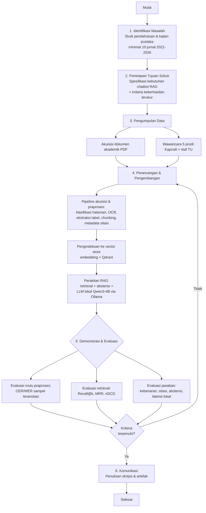
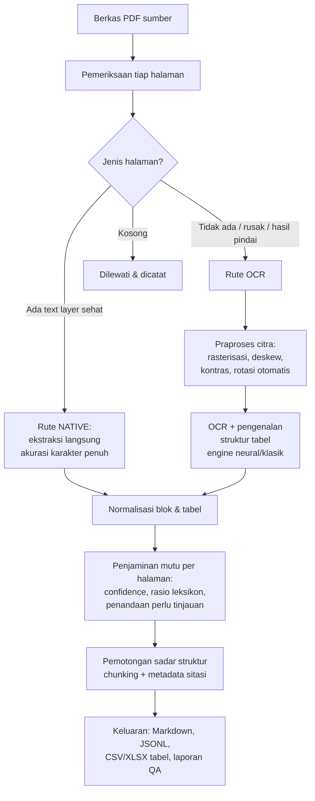
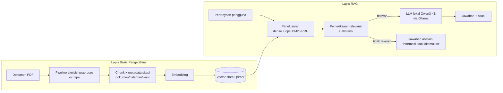

# BAB III METODOLOGI PENELITIAN

> **Catatan pemakaian draf.** Bab ini disusun untuk jalur **perancangan/desain**
> sesuai Panduan Skripsi FTII UHAMKA R.03.25. Draf sudah mengikuti elemen yang
> diminta: metode rinci beserta **tahapan penelitian dalam bentuk diagram
> alir**, **lokasi penelitian**, **peubah yang diamati/diukur**, **model yang
> digunakan**, **rancangan penelitian**, **teknik pengumpulan dan analisis
> data**, uraian **pendekatan kualitatif**, serta **Jadwal Rencana Kegiatan
> Penelitian** dalam format *Time Line Schedule*. Bagian yang bertanda
> *[sepakati dengan pembimbing]* perlu dikonfirmasi lebih dulu. Nama unit,
> jumlah dokumen, dan tanggal bersifat contoh dan harus disesuaikan dengan
> kondisi riil di lapangan.

---

## 3.1 Metode Penelitian

Penelitian ini merupakan penelitian **perancangan (design research)** yang
bertujuan membangun sebuah artefak perangkat lunak, yaitu *chatbot* layanan
informasi akademik berbasis *Retrieval-Augmented Generation* (RAG) dengan model
bahasa besar (LLM) berukuran kecil yang dijalankan secara lokal. Berbeda dengan
penelitian eksperimental murni yang menguji hipotesis melalui manipulasi
variabel terkontrol, penelitian perancangan menitikberatkan pada proses
membangun artefak yang menjawab kebutuhan nyata, lalu mengevaluasi artefak
tersebut terhadap kriteria yang terukur.

Metode payung yang digunakan adalah **Design Science Research Methodology
(DSRM)** sebagaimana dirumuskan Peffers dkk. DSRM dipilih karena secara khusus
dirancang untuk penelitian yang luarannya berupa artefak sistem informasi, dan
karena enam aktivitasnya — identifikasi masalah, penetapan tujuan solusi,
perancangan dan pengembangan, demonstrasi, evaluasi, dan komunikasi — memetakan
dengan rapi ke struktur skripsi Bab I sampai Bab V. Panduan R.03.25 memang
mencantumkan VDI 2221 sebagai salah satu metode perancangan, tetapi VDI 2221
berakar pada rekayasa mekanik dan kurang sesuai untuk rekayasa perangkat lunak;
panduan mengizinkan modifikasi metode dengan justifikasi tertulis, sehingga DSRM
digunakan sebagai kerangka utama dan dipadukan dengan siklus pengembangan
**Prototyping** pada tahap perancangan–pengembangan. *[sepakati dengan
pembimbing]*

Di dalam DSRM, tahap akuisisi dan praproses data menempati posisi kunci karena
mutu jawaban *chatbot* RAG dibatasi oleh mutu basis pengetahuan yang dapat
ditelusurinya. Oleh sebab itu, prosedur pengubahan dokumen akademik mentah
(berkas PDF yang sebagian berupa dokumen digital dan sebagian hasil pindaian)
menjadi korpus terstruktur yang siap diindeks diuraikan secara rinci dan
diperlakukan sebagai salah satu kontribusi perancangan pada penelitian ini.

---

## 3.2 Tahapan Penelitian (Diagram Alir)

Tahapan penelitian disusun mengikuti enam aktivitas DSRM dan ditampilkan sebagai
diagram alir pada Gambar 3.1. Diagram ini dapat digambar ulang menggunakan
perangkat seperti draw.io atau Microsoft Visio; kode sumber diagram (format
Mermaid) disertakan agar mudah direproduksi.

**Gambar 3.1** Diagram alir tahapan penelitian.

Secara ringkas, penelitian dimulai dari identifikasi masalah melalui kajian
pustaka dan studi pendahuluan, dilanjutkan penetapan tujuan solusi beserta
kriteria keberhasilan yang terukur. Tahap pengumpulan data berjalan pada dua
jalur paralel: akuisisi dokumen akademik dan wawancara pada lima program studi.
Tahap perancangan–pengembangan membangun artefak secara iteratif, dimulai dari
pipeline akuisisi–praproses data, pengindeksan, hingga perakitan sistem RAG.
Tahap demonstrasi–evaluasi menguji artefak pada tiga tataran (mutu praproses,
mutu penelusuran, dan mutu jawaban); apabila kriteria belum terpenuhi, penelitian
kembali ke tahap perancangan dalam siklus *prototyping*. Setelah kriteria
terpenuhi, hasil dikomunikasikan dalam bentuk skripsi dan artefak perangkat
lunak.

Khusus untuk sub-proses akuisisi dan praproses data (kotak E1 pada Gambar 3.1),
alur rincinya ditampilkan pada Gambar 3.2.

**Gambar 3.2** Diagram alir sub-proses akuisisi dan praproses data per halaman.

---

## 3.3 Lokasi dan Objek Penelitian

Penelitian dilaksanakan di lingkungan **Fakultas Teknologi Industri dan
Informatika (FTII), Universitas Muhammadiyah Prof. Dr. Hamka (UHAMKA)**.
Pengembangan dan pengujian artefak dilakukan di laboratorium/komputer peneliti,
sedangkan pengumpulan data kebutuhan dan dokumen dilakukan di unit-unit layanan
akademik pada lima program studi di lingkungan FTII. *[sepakati dengan
pembimbing: sebutkan nama kelima prodi dan unit tata usaha yang terlibat]*

**Objek penelitian** adalah layanan informasi akademik yang selama ini dilayani
secara manual oleh staf tata usaha dan dosen, beserta **korpus dokumen akademik**
yang menjadi sumber jawaban, antara lain panduan akademik, panduan penyusunan
skripsi, kalender akademik, kurikulum, surat keputusan terkait layanan, serta
dokumen biaya pendidikan. Dokumen-dokumen inilah yang diproses oleh pipeline
akuisisi–praproses untuk membentuk basis pengetahuan *chatbot*.

**Perangkat pengembangan.** Pengembangan dilakukan pada komputer dengan
prosesor AMD Ryzen 5, kartu grafis NVIDIA RTX 4050 dengan VRAM 6 GB, dan RAM
sistem 8 GB. Keterbatasan RAM 8 GB merupakan kendala nyata yang memengaruhi
pilihan desain: model generatif dibatasi pada kelas kecil (Qwen3-4B) yang
dijalankan melalui Ollama, dan tahap OCR yang menuntut memori besar untuk batch
dokumen berjumlah banyak dialihkan ke lingkungan komputasi awan gratis (Kaggle)
sebagai pengukuran *throughput*, sedangkan pengukuran latensi dan pemakaian VRAM
yang menjadi peubah penelitian tetap dilakukan di perangkat lokal agar hasilnya
mencerminkan kondisi pemakaian nyata.

---

## 3.4 Peubah yang Diamati dan Diukur

Meskipun penelitian ini berjalur perancangan, evaluasi artefak tetap menuntut
peubah yang terdefinisi dan terukur agar klaim keberhasilan dapat
dipertanggungjawabkan di sidang. Peubah dikelompokkan menjadi peubah bebas
(faktor yang divariasikan peneliti), peubah terikat (ukuran mutu yang diamati),
dan peubah terkontrol (dibuat tetap agar perbandingan adil). Tabel 3.1
merangkum peubah beserta definisi operasional, skala, dan jenis datanya.
Penggolongan jenis data (interval/rasio versus nominal/ordinal) penting karena
menentukan jenis uji statistik yang sah dipakai pada Sub-bab 3.8.

**Tabel 3.1** Peubah yang diamati dan diukur.

| Kelompok | Peubah | Definisi operasional | Skala | Jenis data |
| --- | --- | --- | --- | --- |
| Bebas | Rute pemrosesan halaman | Native (text layer) vs OCR | Kategori | Nominal |
| Bebas | Engine OCR | tesseract / docling / paddle / marker | Kategori | Nominal |
| Bebas | Ukuran *chunk* | Target karakter per potongan (mis. 800/1000/1200) | — | Rasio |
| Terikat | *Character Error Rate* (CER) | Jarak edit karakter ternormalisasi terhadap acuan manual | 0–1 | Rasio |
| Terikat | *Word Error Rate* (WER) | Jarak edit kata ternormalisasi terhadap acuan manual | 0–1 | Rasio |
| Terikat | Cakupan ekstraksi tabel | Proporsi tabel yang terekstrak benar strukturnya | 0–1 | Rasio |
| Terikat | Recall@k penelusuran | Proporsi kueri yang dokumen relevannya masuk k teratas | 0–1 | Rasio |
| Terikat | MRR / nDCG@k | Mutu peringkat hasil penelusuran | 0–1 | Rasio |
| Terikat | Kebenaran jawaban | Penilaian benar/sebagian/salah terhadap kunci | Ordinal | Ordinal |
| Terikat | Ketepatan sitasi | Jawaban menyebut dokumen–halaman–versi yang benar | Benar/Salah | Nominal |
| Terikat | Ketepatan abstensi | Sistem menolak menjawab saat tidak ada bukti relevan | Benar/Salah | Nominal |
| Terikat | Latensi jawaban | Waktu dari kueri hingga jawaban selesai (lokal) | detik | Rasio |
| Terikat | Pemakaian VRAM/RAM | Puncak memori saat inferensi (lokal) | MB | Rasio |
| Terkontrol | Perangkat keras | RTX 4050 6 GB, RAM 8 GB (untuk latensi/VRAM) | — | — |
| Terkontrol | Model LLM & kuantisasi | Qwen3-4B-Instruct, level kuantisasi tetap | — | — |
| Terkontrol | Himpunan kueri uji | Daftar pertanyaan uji yang sama antar kondisi | — | — |

Keenam kategori peubah pada Panduan R.03.25 terpenuhi: peubah bebas, terikat,
dan terkontrol dinyatakan di atas; definisi operasional diberikan pada kolom
ketiga; satuan/skala pada kolom keempat; dan instrumen pengukur diuraikan pada
Sub-bab 3.7 (pipeline akuisisi–praproses, protokol wawancara, serta skrip
evaluasi CER/WER dan metrik penelusuran).

---

## 3.5 Model yang Digunakan

Model konseptual sistem terdiri atas dua lapis yang saling bergantung:
**lapis basis pengetahuan** (hasil akuisisi–praproses dokumen) dan **lapis RAG**
(penelusuran dan pembangkitan jawaban). Gambar 3.3 menggambarkan arsitektur
sasaran.

**Gambar 3.3** Arsitektur sistem *chatbot* RAG.

### 3.5.1 Model akuisisi dan praproses data

Model akuisisi–praproses diwujudkan sebagai pipeline perangkat lunak bernama
`ocrpipe` yang dibangun pada penelitian ini. Prinsip rancangannya:

Pertama, **keputusan per halaman, bukan per dokumen.** Setiap halaman diperiksa:
bila memiliki *text layer* yang sehat, teksnya dibaca langsung tanpa OCR
sehingga akurasi karakter penuh dan biaya komputasi nol; hanya halaman hasil
pindaian atau yang *text layer*-nya rusak yang dialihkan ke OCR. Kesehatan
*text layer* dinilai dari kepadatan karakter, keberadaan objek visual, serta
rasio karakter rusak (misalnya kode `(cid:NN)` dari *font* tak tertanam dan
karakter pengganti Unicode). Pendekatan ini penting karena korpus akademik
nyata bersifat **campuran**: panduan hasil ekspor pengolah kata berdampingan
dengan lampiran surat keputusan bertanda tangan yang hanya tersedia sebagai
pindaian.

Kedua, **tabel diperlakukan sebagai entitas terstruktur.** Tabel diekstrak
berikut strukturnya, dinormalisasi menjadi *grid* persegi dengan penanganan sel
tergabung, lalu diekspor ke Markdown, CSV per tabel, dan XLSX multi-lembar.
Pada tahap *chunking*, tabel tidak pernah dipotong di tengah baris; tabel panjang
dipecah per baris dengan baris tajuk diulang pada tiap pecahan agar tetap
bermakna saat ditelusuri.

Ketiga, **setiap potongan membawa metadata sitasi.** Tiap *chunk* menyimpan
pengenal dokumen, judul, versi, tanggal berlaku, rentang halaman, dan jejak
bagian (Bab > Sub-bab). Dengan demikian *chatbot* dapat menjawab sambil menyebut
sumber dalam bentuk "dokumen X, halaman N, versi V" tanpa kueri tambahan —
memenuhi kebutuhan ketertelusuran yang menjadi salah satu kriteria keberhasilan.

Pemilihan *engine* OCR mengikuti ketersediaan dan karakteristik dokumen:
Tesseract sebagai jaring pengaman yang ringan dan berjalan di CPU; Docling dan
PaddleOCR PP-StructureV3 sebagai *engine* neural dengan pengenalan struktur tabel
yang lebih kuat untuk halaman pindaian. Pemilihan ini dicatat pada berkas
`manifest.json` beserta versi seluruh pustaka dan konfigurasi efektif, sehingga
proses dapat direproduksi dan diaudit.

### 3.5.2 Model RAG

Lapis RAG menggunakan penelusuran *dense* terhadap vektor dokumen di Qdrant,
dengan opsi penggabungan BM25 melalui *Reciprocal Rank Fusion* dan penataan
ulang (*re-ranking*) memakai *cross-encoder* bila dibutuhkan. Sebelum jawaban
dibangkitkan, dilakukan pemeriksaan relevansi; bila tidak ada bukti yang cukup,
sistem **abstain** (menolak menjawab) alih-alih mengarang. Jawaban dibangkitkan
oleh LLM lokal Qwen3-4B-Instruct melalui Ollama dan selalu disertai sitasi.
Rincian penetapan model embedding, nilai k, ambang abstensi, dan level
kuantisasi ditetapkan secara empiris pada tahap pengembangan dan dilaporkan
sebagai bagian hasil. *[sepakati dengan pembimbing]*

---

## 3.6 Rancangan Penelitian

Rancangan penelitian mengikuti enam aktivitas DSRM yang dijalankan dengan siklus
*prototyping* iteratif pada aktivitas perancangan–pengembangan–evaluasi.

Pada **aktivitas 1 (identifikasi masalah)**, dilakukan kajian pustaka minimal
sepuluh artikel jurnal terbitan 2021–2026 dan studi pendahuluan atas praktik
layanan informasi akademik yang berjalan. **Aktivitas 2 (penetapan tujuan
solusi)** merumuskan spesifikasi kebutuhan dan kriteria keberhasilan terukur
(lihat Sub-bab 3.4). **Aktivitas 3 (perancangan dan pengembangan)** membangun
artefak secara bertahap: pipeline akuisisi–praproses lebih dulu karena menjadi
fondasi mutu, kemudian pengindeksan, lalu perakitan RAG. **Aktivitas 4
(demonstrasi)** menjalankan sistem pada himpunan kueri uji. **Aktivitas 5
(evaluasi)** mengukur peubah terikat; bila kriteria belum tercapai, dilakukan
iterasi perbaikan (misalnya menaikkan resolusi rasterisasi, mengganti *engine*
OCR untuk halaman bertabel, atau menyetel ukuran *chunk*). **Aktivitas 6
(komunikasi)** menuliskan temuan ke dalam skripsi dan merapikan artefak.

Rancangan evaluasi mutu praproses menggunakan **pembandingan terhadap acuan
(ground truth)**: sejumlah halaman dipilih secara terstratifikasi — sebagian
halaman digital, sebagian hasil pindaian — lalu ditranskripsi manual sebagai
acuan, dan keluaran pipeline dibandingkan terhadapnya untuk menghitung CER/WER.
Stratifikasi diperlukan agar mutu kedua rute pemrosesan terukur; mengukur hanya
halaman digital akan menghasilkan galat mendekati nol dan menyesatkan.

---

## 3.7 Teknik Pengumpulan Data

Pengumpulan data dilakukan melalui tiga teknik yang saling melengkapi.

**Pertama, studi dokumen (akuisisi korpus).** Dokumen akademik dikumpulkan dari
unit layanan di lima program studi dan tingkat fakultas. Setiap dokumen dicatat
metadatanya (judul, kategori, versi, tanggal berlaku, unit penerbit) dalam
berkas `metadata.csv`. Dokumen kemudian diproses oleh pipeline `ocrpipe` yang
berperan sebagai **instrumen pengumpul data terotomasi**: ia mengubah berkas PDF
menjadi korpus terstruktur sekaligus menghasilkan laporan penjaminan mutu.
Prosedur operasionalnya: (a) survei jenis halaman dengan perintah `diagnose`
untuk mengetahui proporsi halaman digital dan pindaian; (b) ekstraksi dengan
perintah `ingest`; (c) peninjauan laporan QA untuk menandai halaman yang perlu
koreksi manual; (d) bila perlu, pemrosesan ulang halaman tertentu dengan
*engine* atau parameter berbeda.

**Kedua, wawancara.** Wawancara semi-terstruktur dilakukan terhadap Ketua
Program Studi dan staf tata usaha pada lima program studi untuk menggali
kebutuhan informasi, jenis pertanyaan yang paling sering diajukan mahasiswa,
serta dokumen rujukan yang menjadi sumber jawaban. Wawancara ini menjadi dasar
penyusunan himpunan kueri uji dan penentuan cakupan korpus. Instrumen yang
dipakai berupa protokol wawancara terstandar beserta lembar pencatat. Hasil
wawancara juga dipakai untuk menilai divergensi jawaban antar program studi atas
pertanyaan serupa, yang menjadi salah satu sudut kebaruan penelitian.

**Ketiga, pembangkitan data uji.** Dari hasil akuisisi dan wawancara disusun
himpunan pertanyaan uji beserta kunci jawaban dan dokumen rujukannya. Himpunan
ini dipakai pada tahap demonstrasi–evaluasi untuk mengukur mutu penelusuran dan
mutu jawaban.

Untuk pengukuran akurasi OCR, sampel halaman disiapkan dengan perintah `sample`
yang melakukan pemilihan terstratifikasi dan menyediakan berkas acuan kosong
untuk diisi secara manual sesuai pedoman transkripsi yang disertakan, agar
perlakuan transkripsi konsisten antar penilai.

---

## 3.8 Teknik Analisis Data

Analisis data memadukan pendekatan kuantitatif dan kualitatif sesuai jenis data
pada Tabel 3.1.

**Analisis mutu praproses.** CER dan WER dihitung sebagai jarak edit (Levenshtein)
ternormalisasi antara keluaran mesin dan transkrip acuan. Agregasi dilakukan
secara **mikro** (berbobot panjang acuan), bukan rata-rata sederhana antar
halaman, sejalan dengan praktik pelaporan baku pada pengenalan teks. Perlakuan
normalisasi (penyeragaman huruf besar/kecil dan penanganan tanda baca)
dilaporkan secara eksplisit karena memengaruhi angka dan diperlukan agar hasil
dapat dibandingkan antar penelitian. CER/WER dilaporkan terpisah untuk halaman
rute native dan rute OCR.

**Analisis mutu penelusuran dan jawaban.** Recall@k, MRR, dan nDCG@k dihitung
atas himpunan kueri uji. Kebenaran jawaban dinilai dengan rubrik
benar/sebagian/salah; ketepatan sitasi dan ketepatan abstensi dinilai secara
biner. Latensi dan pemakaian memori diukur di perangkat lokal.

**Pemilihan uji statistik menurut jenis data.** Sesuai Panduan R.03.25 yang
membedakan statistik parametris dan nonparametris:

- Untuk peubah berjenis **interval/rasio** (CER, WER, latensi, Recall@k, nDCG)
  yang membandingkan dua kondisi atau lebih — misalnya perbandingan antar
  *engine* OCR atau antar ukuran *chunk* — digunakan **statistik parametris**
  (uji-t berpasangan atau ANOVA) apabila asumsi kenormalan dan homogenitas
  ragam terpenuhi.
- Apabila asumsi tidak terpenuhi atau ukuran sampel kecil, digunakan padanan
  **nonparametris** (uji Wilcoxon *signed-rank* atau Friedman).
- Untuk peubah berjenis **nominal/ordinal** (kebenaran jawaban, ketepatan sitasi,
  ketepatan abstensi) digunakan **statistik nonparametris** seperti uji
  McNemar atau uji Chi-kuadrat, sesuai rancangan perbandingan.

Statistik deskriptif (rerata, simpangan baku, median, rentang) disajikan untuk
seluruh peubah terikat guna menggambarkan sebaran hasil. *[sepakati dengan
pembimbing: tetapkan secara pasti perbandingan mana yang akan diuji secara
inferensial agar jumlah sampel memadai]*

---

## 3.9 Pendekatan Kualitatif

Komponen kualitatif penelitian ini berpusat pada **elicitasi kebutuhan** melalui
wawancara pada lima program studi. Pendekatan yang digunakan adalah analisis
tematik terhadap data wawancara.

**Pengumpulan informasi.** Wawancara semi-terstruktur direkam (dengan izin) dan
dicatat pada lembar pencatat terstandar. Narasumber terdiri atas Ketua Program
Studi dan staf tata usaha sehingga diperoleh perspektif kebijakan sekaligus
praktik layanan sehari-hari.

**Analisis informasi.** Catatan dan transkrip wawancara dikodekan (*coding*)
untuk mengidentifikasi tema berulang: jenis pertanyaan yang paling sering muncul,
dokumen rujukan yang dipakai, titik-titik kebingungan mahasiswa, dan perbedaan
prosedur antar program studi. Kode-kode kemudian dikelompokkan menjadi kategori
kebutuhan fungsional sistem.

**Penafsiran.** Kategori kebutuhan ditafsirkan untuk menentukan cakupan korpus
yang harus diakuisisi, bentuk pertanyaan yang harus mampu dijawab *chatbot*,
serta kebutuhan khusus seperti penanganan perbedaan jawaban antar program studi.
Penafsiran dilakukan dengan mempertautkan temuan wawancara dan karakteristik
dokumen hasil akuisisi.

**Penarikan kesimpulan.** Kesimpulan kualitatif dirumuskan sebagai daftar
kebutuhan fungsional dan nonfungsional yang menjadi masukan perancangan sistem,
serta sebagai dasar penyusunan himpunan kueri uji. Keabsahan temuan dijaga
melalui triangulasi sumber (membandingkan keterangan Kaprodi dan staf tata
usaha) dan pengecekan silang terhadap isi dokumen resmi.

---

## 3.10 Jadwal Rencana Kegiatan Penelitian (Time Line Schedule)

Jadwal disusun untuk rentang enam bulan dan dapat disesuaikan setelah disepakati
bersama dosen pembimbing. Satu salinan jadwal ini direkomendasikan untuk
diserahkan kepada pembimbing agar perkembangan penelitian dapat dipantau kedua
belah pihak. Tanda ● menunjukkan bulan pelaksanaan kegiatan.
*[sepakati dengan pembimbing; sesuaikan bulan dengan kalender bimbingan]*

**Tabel 3.2** Time Line Schedule rencana kegiatan penelitian.

| No | Kegiatan | Okt 2026 | Nov 2026 | Des 2026 | Jan 2027 | Feb 2027 | Mar 2027 |
| --- | --- | :---: | :---: | :---: | :---: | :---: | :---: |
| 1 | Studi pendahuluan & kajian pustaka (≥10 jurnal 2021–2026) | ● | ● |  |  |  |  |
| 2 | Penyusunan proposal & seminar proposal | ● | ● |  |  |  |  |
| 3 | Perizinan & wawancara 5 prodi (Kaprodi + TU) |  | ● | ● |  |  |  |
| 4 | Akuisisi dokumen & penyusunan metadata korpus |  | ● | ● |  |  |  |
| 5 | Pengembangan pipeline akuisisi–praproses (ocrpipe) |  | ● | ● | ● |  |  |
| 6 | Anotasi sampel & pengukuran CER/WER |  |  | ● | ● |  |  |
| 7 | Pengindeksan korpus (embedding + Qdrant) |  |  | ● | ● |  |  |
| 8 | Perakitan RAG (retrieval, abstensi, LLM lokal) |  |  |  | ● | ● |  |
| 9 | Penyusunan kueri uji & evaluasi sistem |  |  |  | ● | ● |  |
| 10 | Iterasi perbaikan (prototyping) |  |  |  | ● | ● | ● |
| 11 | Analisis data & pembahasan hasil |  |  |  |  | ● | ● |
| 12 | Penulisan Bab IV–V & penyusunan artefak |  |  |  |  | ● | ● |
| 13 | Finalisasi, bimbingan akhir & sidang skripsi |  |  |  |  |  | ● |

Rincian aktivitas untuk tahap yang paling padat (pengembangan pipeline
akuisisi–praproses, kegiatan No. 5–7) diuraikan lebih spesifik pada Tabel 3.3
agar alur kerja peneliti terlihat jelas.

**Tabel 3.3** Rincian kegiatan tahap akuisisi dan praproses data.

| Minggu | Kegiatan rinci | Luaran |
| --- | --- | --- |
| M-1 | Survei jenis halaman seluruh korpus (`diagnose`); penetapan proporsi digital vs pindaian | Laporan diagnosa per dokumen & per halaman |
| M-2 | Konfigurasi pipeline; uji ekstraksi rute native pada dokumen digital | Keluaran Markdown/JSONL awal + uji otomatis lulus |
| M-3 | Penyetelan praproses citra (deskew, kontras) & pemilihan engine OCR untuk halaman pindaian | Konfigurasi efektif terdokumentasi di manifest |
| M-4 | Ekstraksi penuh korpus; pemeriksaan laporan QA; koreksi halaman bertanda perlu tinjauan | Korpus terstruktur + laporan QA final |
| M-5 | Penyiapan sampel terstratifikasi & transkripsi manual acuan | Berkas acuan (ref) + hipotesis (hyp) |
| M-6 | Perhitungan CER/WER; analisis halaman bergalat tinggi; pemrosesan ulang bila perlu | Tabel CER/WER + simpulan mutu praproses |
| M-7 | Pengindeksan chunk ke Qdrant; verifikasi metadata sitasi (dokumen/halaman/versi) | Vector store siap untuk lapis RAG |

---

## Lampiran Bab III: Pemetaan artefak ke prosedur

Agar prosedur dapat ditelusuri dan direproduksi, setiap langkah akuisisi–praproses
dipetakan ke perintah dan luaran konkret pada artefak `ocrpipe`:

| Langkah metodologi | Perintah/komponen | Luaran yang menjadi bukti |
| --- | --- | --- |
| Survei jenis halaman | `cek_pdf.py`, `run_ocr.py diagnose` | `diagnosa-dokumen.csv`, `diagnosa-halaman.csv` |
| Klasifikasi & ekstraksi | `run_ocr.py ingest` | `markdown/`, `jsonl/`, `tabel/` |
| Penjaminan mutu otomatis | modul QA | `qa/laporan-qa.md`, `qa/qa-per-halaman.csv` |
| Pengukuran akurasi | `run_ocr.py sample` lalu `eval` | `hasil-cer-wer.csv`, `hasil-cer-wer.json` |
| Reproduktibilitas | penulisan manifest | `manifest.json`, `konfigurasi-efektif.yaml` |
| Persiapan ingest RAG | contoh ingest | `contoh-ingest-qdrant.py` |

> **Pengingat metodologis.** Metrik pada laporan QA bersifat **deteksi anomali**
> (penyaringan otomatis), bukan ukuran akurasi. Satu-satunya angka akurasi yang
> sah dilaporkan pada Bab IV adalah CER/WER hasil pembandingan terhadap transkrip
> manual. Hindari pernyataan mutlak semacam "belum ada penelitian yang…";
> pernyataan kesenjangan sebaiknya dipersempit menjadi klaim yang dapat
> diverifikasi, misalnya "evaluasi yang ada belum mengukur ketepatan sitasi
> berbasis versi dokumen pada konteks layanan akademik".

